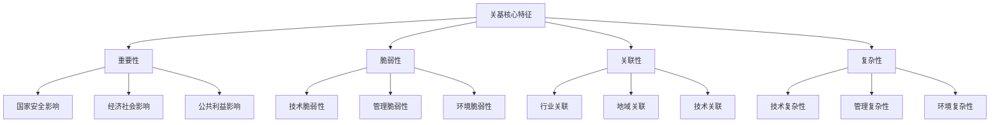

# CII

# Critical Infrastructure Protection Study Notes

## Part One: Conceptual Foundations and Theoretical Framework

### 1. Core Concepts of Critical Information Infrastructure Protection

### 1.1 Definition and Meaning

Critical Information Infrastructure Protection (CIIP) is an important component of a national cybersecurity strategy. It refers to the system of focused protection applied to the information infrastructure that bears on national security, the national economy and people's livelihood, and the public interest.

**Legal definition:** According to the *Regulations on the Security and Protection of Critical Information Infrastructure*, critical information infrastructure refers to information infrastructure in important industries and sectors such as public communications and information services, energy, transport, water conservancy, finance, public services, e-government, and defense science, technology and industry, as well as other information infrastructure that, once damaged, deprived of function, or subjected to a data breach, may seriously endanger national security, the national economy and people's livelihood, or the public interest.

### 1.2 Analysis of Core Characteristics



### 1.3 Architecture of the Protection System

**Four-layer protection architecture:**

```
┌─────────────────────────────────────────┐
│            法律制度层                      │
│  《网络安全法》《关基保护条例》等           │
└─────────────────────────────────────────┘
┌─────────────────────────────────────────┐
│            标准规范层                      │
│  国家标准、行业标准、团体标准等             │
└─────────────────────────────────────────┘
┌─────────────────────────────────────────┐
│            管理制度层                      │
│  识别认定、安全保护、检测评估等             │
└─────────────────────────────────────────┘
┌─────────────────────────────────────────┐
│            技术实现层                      │
│  防护技术、监测技术、应急技术等             │
└─────────────────────────────────────────┘

```

### 2. The Eight Key Sectors in Detail

### 2.1 Sector Classification and Characteristics

| Sector | Typical facilities | Main threats | Protection focus |
| --- | --- | --- | --- |
| **Public communications and information services** | Telecom networks, Internet infrastructure | DDoS attacks, data theft | Network stability, data security |
| **Energy** | Power grids, oil and gas pipeline networks | ICS attacks, physical destruction | Continuous supply, equipment safety |
| **Transport** | Civil aviation, railways, ports | Signal interference, system paralysis | Operational safety, emergency response |
| **Water conservancy** | Reservoirs, water treatment plants, drainage systems | Environmental monitoring, water supply safety | Water quality safety, facility protection |
| **Finance** | Banks, securities, insurance | Fund theft, data leakage | Transaction security, customer protection |
| **Public services** | Healthcare, education, social security | Privacy leakage, service interruption | Information protection, service continuity |
| **E-government** | Government information systems | Political attacks, leakage of classified information | Government affairs security, citizen privacy |
| **Defense science, technology and industry** | Information systems of defense enterprises | Technology theft, subversive infiltration | Technology confidentiality, production safety |

### 2.2 Cross-Sector Interdependency Analysis

Modern critical information infrastructure is highly interdependent:

- **Technological interdependence:** shared communications networks, cloud computing platforms, and foundational hardware and software
- **Data interdependence:** cross-sector data flows and the need for information sharing
- **Service interdependence:** support from foundational services and shared emergency resources

---

## Part Two: Institutional Comparison and Interdependency Analysis

### 3. In-Depth Comparison Between CII Protection and Classified Protection Level 3

### 3.1 Differences in Institutional Design Philosophy

**Classified Protection system:**

- **Design philosophy:** tiered, differentiated protection
- **Core idea:** the protection level is determined by the importance of the system and the severity of damage if it is compromised
- **Scope of application:** all networks and information systems across society

**CII Protection system:**

- **Design philosophy:** dedicated protection for key sectors
- **Core idea:** special protection measures are applied to the nation's key sectors
- **Scope of application:** critical facilities in the eight important sectors and fields

### 3.2 Technical Requirement Comparison Matrix

| Technical domain | Classified Protection Level 3 requirements | Additional CII requirements | Description of differences |
| --- | --- | --- | --- |
| **Physical security** | Basic protective measures | Reinforced physical protection, redundancy guarantees | Stricter access control and environmental requirements |
| **Network security** | Perimeter protection, access control | Dedicated network construction, defense in depth | Independent networks, high-grade isolation |
| **Host security** | Basic security configuration | Hardening standards, enhanced monitoring | Stricter configuration and monitoring requirements |
| **Application security** | Application-layer protection | Business security, data protection | Business continuity and data classification and grading |
| **Data security** | Data integrity protection | Identification of important data, outbound transfer controls | Dedicated data security protection measures |
| **Supply chain security** | Basic procurement security | Full-chain security review | Strict supplier management and product review |

### 3.3 Analysis of Enhanced Management Requirements

```
等保三级管理要求基础上的关基增强：

管理制度 ➤ 专门制度（网络安全负责人制度、重要岗位人员管理）
管理机构 ➤ 专门机构（网络安全和信息化委员会、专业团队）
人员管理 ➤ 严格审查（背景调查、定期培训、违规追责）
建设管理 ➤ 安全审查（产品服务审查、供应链管理）
运维管理 ➤ 强化运维（7×24监控、应急值守、定期演练）

```

### 4. Synergistic Relationship and Integration Mechanisms

### 4.1 Institutional Integration Model

```
制度融合三层模型：
┌─────────────────────────────────────┐
│         关基专门保护层                │ ← 行业特色要求
│   供应链安全、重要数据保护等           │
├─────────────────────────────────────┤
│         等保增强要求层                │ ← 高等级通用要求
│   等保三级/四级技术和管理要求         │
├─────────────────────────────────────┤
│         网络安全基础层                │ ← 基础安全要求
│   基本的网络安全防护措施              │
└─────────────────────────────────────┘

```

### 4.2 Implementation Coordination Mechanisms

- **Dual supervision:** public security organs (Classified Protection) + sector regulators (CII)
- **Standard alignment:** Classified Protection standards as the baseline, CII standards as the enhancement
- **Coordinated assessment:** unified assessment standards with dedicated assessment requirements
- **Supervision and inspection:** regular inspections, special inspections, and joint inspections

---

## Part Three: Practical Application and Case Analysis

### 5. How CII Works Within Classified Protection Assessment

### 5.1 Mechanisms for Raising Assessment Standards

**Progressive standards model:**

```
基础等保要求
    ↓ （技术要求叠加）
行业专门标准
    ↓ （管理要求增强）
关基保护要求
    ↓ （实施效果验证）
综合安全测评

```

**Specific manifestations of the enhancement:**

1. **Greater assessment depth:** from basic testing to in-depth evaluation
2. **Broader assessment scope:** from a single system to the surrounding ecosystem
3. **Higher assessment standards:** from compliance to effectiveness
4. **More frequent assessment:** from annual assessment to continuous monitoring

### 5.2 Mechanisms for Enhancing Risk Assessment

**Upgraded risk assessment framework:**

```
传统风险评估 → 关基风险评估

资产识别 → 资产识别 + 关键资产认定
威胁分析 → 威胁分析 + 高级威胁建模
脆弱性识别 → 脆弱性识别 + 供应链风险
风险计算 → 风险计算 + 国家安全影响
风险处置 → 风险处置 + 应急预案联动

```

### 6. In-Depth Case Studies of Typical Sectors

### Case 1: CII Protection in the Digital Transformation of the Power Sector

**Background overview:**
As a foundational industry of the national economy, the power sector has become increasingly digitized. With the advance of smart grids, new energy grid connection, and power market reform, power information systems face new security challenges.

**CII identification and classification:**

```
电力行业关基分级体系：
├── 国家级（等保四级）
│   ├── 国家电网调度中心
│   ├── 南方电网调度中心
│   └── 大区电网调度中心
├── 区域级（等保三级）
│   ├── 省网调度中心
│   ├── 地调调度中心
│   └── 重要电厂控制系统
└── 本地级（等保二/三级）
    ├── 县调调度系统
    ├── 配电自动化系统
    └── 用电信息采集系统

```

**Assessment focus and methods:**

1. **Security assessment of power monitoring systems**
    - Assessment targets: SCADA systems, EMS systems, dispatch automation systems
    - Assessment focus: real-time data integrity, safety of control commands, system availability
    - Assessment methods: functional testing, performance testing, security penetration testing
2. **Security assessment of power communications networks**
    - Assessment targets: dedicated power communications networks, dispatch data networks
    - Assessment focus: network isolation, data encryption, access control
    - Assessment methods: network architecture analysis, communications protocol testing, security configuration review
3. **Supply chain security assessment**
    - Assessment targets: critical equipment suppliers, software service providers, operations and maintenance service providers
    - Assessment focus: supplier qualifications, product security, service security
    - Assessment methods: qualification review, product testing, on-site assessment

**Actual results and experience:**

- A security protection system covering every stage—generation, transmission, distribution, and consumption—was established
- A cybersecurity assurance model that gives equal weight to "management + technology" was formed
- The power system's resistance to attacks and its emergency recovery capability were improved

### Case 2: Security Challenges in the Digital Transformation of the Financial Sector

**Sector characteristics and challenges:**
The financial sector is a priority target for cybersecurity protection. The main challenges it faces include:

- Diversifying external threats: cyber attacks, fraudulent activity, data theft
- More complex internal risks: employee violations, system failures, operational errors
- Stricter regulatory requirements: compliance requirements, data protection, risk control

**Identification of CII systems:**

```
银行业关基系统典型架构：
├── 核心业务系统（四级关基）
│   ├── 账务处理系统
│   ├── 支付清算系统
│   ├── 信贷管理系统
│   └── 风险控制系统
├── 渠道服务系统（三级关基）
│   ├── 网上银行系统
│   ├── 手机银行系统
│   ├── 电话银行系统
│   └── 自助设备系统
└── 管理支撑系统（三级）
    ├── 数据仓库系统
    ├── 决策支持系统
    ├── 监管报送系统
    └── 内控合规系统

```

**Key points of Classified Protection assessment:**

1. **Transaction security assessment**
    
    ```
    测评维度：
    ├── 身份认证（多因子认证、生物识别）
    ├── 交易完整性（数字签名、消息认证）
    ├── 交易不可否认（电子签名、审计日志）
    └── 交易监控（实时监控、异常检测）
    
    ```
    
2. **Data security protection assessment**
    - Identification, classification, and grading of sensitive data
    - Encrypted data storage and transmission
    - Data access permission control
    - Data backup and recovery verification
3. **Business continuity assessment**
    - Construction and verification of disaster recovery systems
    - Formulation and rehearsal of emergency plans
    - Testing of recovery time objectives (RTO) for critical business
    - Verification of recovery point objectives (RPO) for data

**Innovative practice case:**
During its Classified Protection assessment, a large bank innovatively adopted a "business scenario-based testing" approach:

- Simulating real business scenarios to conduct security testing
- Verifying security protection capability during business peaks
- Evaluating the effectiveness of business continuity assurance measures
- Testing the actual effect of the emergency response mechanism

### Case 3: Security Protection Practice for Intelligent Transport Systems

**System overview:**
Intelligent transport systems integrate IoT, big data, artificial intelligence, and other technologies to make traffic management intelligent and fine-grained. As urban critical infrastructure, their security protection is crucial.

**Technical architecture and security challenges:**

```
智慧交通系统分层架构：
├── 感知层
│   ├── 交通检测器（流量、速度、占有率）
│   ├── 视频监控设备（违法抓拍、事件检测）
│   ├── 信号控制设备（信号灯、控制器）
│   └── 移动检测设备（车载、手持设备）
├── 网络层
│   ├── 有线通信网（光纤、以太网）
│   ├── 无线通信网（WiFi、4G/5G、专网）
│   └── 物联网通信（LoRa、NB-IoT）
├── 平台层
│   ├── 交通管理平台（信号控制、交通诱导）
│   ├── 数据分析平台（大数据、AI算法）
│   ├── 应急指挥平台（事件处理、资源调度）
│   └── 公众服务平台（信息发布、出行服务）
└── 应用层
    ├── 交通管控应用
    ├── 出行服务应用
    ├── 应急响应应用
    └── 数据分析应用

```

**Security risks and protective measures:**

1. **Security risks at the perception layer**
    - Device physical security: anti-theft, anti-damage, anti-tampering
    - Communications security: encrypted data transmission, identity authentication
    - Data security: data integrity and availability protection
2. **Security protection at the network layer**
    - Network isolation: separation of the business network from the management network
    - Access control: role-based access control (RBAC)
    - Intrusion prevention: deployment of IDS/IPS, firewalls, and other devices
3. **Security assurance at the platform layer**
    - System security: security hardening of operating systems and middleware
    - Application security: code auditing, vulnerability scanning, security testing
    - Data security: data encryption, backup and recovery, privacy protection

**Key points for implementing the Classified Protection assessment:**

1. **Real-time capability testing**
    - Signal control response time testing
    - Event detection and handling time testing
    - System concurrent processing capability testing
    - Network latency and bandwidth testing
2. **Reliability verification testing**
    - System fault tolerance testing
    - Automatic failover testing for device failures
    - Data backup and recovery testing
    - Disaster recovery drill testing
3. **Security protection capability testing**
    - Network attack protection testing
    - Malicious code protection testing
    - Data leakage prevention testing
    - Physical security protection checks

**Practical application results:**
Through systematic CII protection and Classified Protection assessment, the intelligent transport system achieved:

- A 20–30% improvement in traffic efficiency
- A 15–25% reduction in traffic accidents
- A 50% shorter emergency response time
- Significantly enhanced system security protection capability

### 7. Assessment Implementation Methods and Quality Assurance

### 7.1 CII-Oriented Assessment Methodology

**Assessment implementation framework:**

```
关基等保测评完整流程：
├── 准备阶段（1-2周）
│   ├── 关基认定文件确认
│   ├── 系统调研与边界确定
│   ├── 测评方案设计与审核
│   ├── 测评工具准备与配置
│   └── 测评团队组建与培训
├── 实施阶段（2-4周）
│   ├── 基础等保要求测试
│   │   ├── 技术类控制点测试
│   │   └── 管理类控制点测试
│   ├── 关基专门要求验证
│   │   ├── 供应链安全评估
│   │   ├── 重要数据保护检查
│   │   ├── 网络安全审查验证
│   │   └── 应急能力实际测试
│   └── 深度安全评估
│       ├── 威胁建模与风险分析
│       ├── 渗透测试与漏洞挖掘
│       └── 业务连续性验证测试
├── 报告阶段（1-2周）
│   ├── 测评数据整理分析
│   ├── 风险等级评估判定
│   ├── 测评报告编写审核
│   └── 整改建议措施制定
└── 跟踪阶段（持续）
    ├── 整改措施实施跟踪
    ├── 整改效果验证确认
    ├── 持续监督检查安排
    └── 下一轮测评计划制定

```

### 7.2 Assessment Quality Control System

**Quality assurance measures:**

1. **Personnel qualification assurance**
    - Assessors possess relevant sector background knowledge
    - Assessors have mastered the dedicated CII protection requirements and standards
    - Assessors have extensive hands-on project experience
2. **Assessment tooling assurance**
    - Use of professional security assessment tools
    - Assessment methods customized to the characteristics of CII
    - Continuous updating of the tool library and knowledge base
3. **Process quality control**
    - Full recording and supervision of the assessment process
    - Quality checkpoints set at key milestones
    - Cross-verification and review of assessment results
4. **Report quality assurance**
    - Standardized assessment report templates
    - Consistency in risk determination criteria
    - Targeted and actionable remediation recommendations
