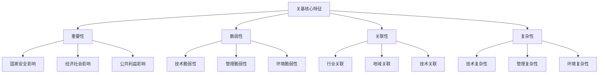

# 关基

# 关键基础设施保护学习文档

## 第一部分：概念基础与理论框架

### 1. 关键信息基础设施保护核心概念

### 1.1 定义与内涵

关键信息基础设施保护（Critical Information Infrastructure Protection, CIIP）是国家网络安全战略的重要组成部分，是指对关系国家安全、国计民生、公共利益的信息基础设施实施的重点保护制度。

**法律定义：** 根据《关键信息基础设施安全保护条例》，关键信息基础设施是指公共通信和信息服务、能源、交通、水利、金融、公共服务、电子政务、国防科技工业等重要行业和领域的，以及其他一旦遭到破坏、丧失功能或者数据泄露，可能严重危害国家安全、国计民生、公共利益的信息基础设施。

### 1.2 核心特征分析



### 1.3 保护制度体系架构

**四层保护架构：**

```
┌─────────────────────────────────────────┐
│            法律制度层                      │
│  《网络安全法》《关基保护条例》等           │
└─────────────────────────────────────────┘
┌─────────────────────────────────────────┐
│            标准规范层                      │
│  国家标准、行业标准、团体标准等             │
└─────────────────────────────────────────┘
┌─────────────────────────────────────────┐
│            管理制度层                      │
│  识别认定、安全保护、检测评估等             │
└─────────────────────────────────────────┘
┌─────────────────────────────────────────┐
│            技术实现层                      │
│  防护技术、监测技术、应急技术等             │
└─────────────────────────────────────────┘

```

### 2. 八大重点行业领域详解

### 2.1 行业分类与特点

| 行业领域 | 典型设施 | 主要威胁 | 保护重点 |
| --- | --- | --- | --- |
| **公共通信和信息服务** | 电信网络、互联网基础设施 | DDoS攻击、数据窃取 | 网络稳定、数据安全 |
| **能源** | 电网、油气管网 | 工控攻击、物理破坏 | 连续供应、设备安全 |
| **交通** | 民航、铁路、港口 | 信号干扰、系统瘫痪 | 运营安全、应急响应 |
| **水利** | 水库、水厂、排水系统 | 环境监控、供水安全 | 水质安全、设施防护 |
| **金融** | 银行、证券、保险 | 资金盗取、数据泄露 | 交易安全、客户保护 |
| **公共服务** | 医疗、教育、社保 | 隐私泄露、服务中断 | 信息保护、服务连续 |
| **电子政务** | 政府信息系统 | 政治攻击、机密泄露 | 政务安全、公民隐私 |
| **国防科技工业** | 军工企业信息系统 | 技术窃取、破坏渗透 | 技术保密、生产安全 |

### 2.2 跨行业关联分析

现代关键信息基础设施具有高度的相互依赖性：

- **技术依赖：** 共享通信网络、云计算平台、基础软硬件
- **数据依赖：** 跨行业数据流动、信息共享需求
- **服务依赖：** 基础服务支撑、应急资源共享

---

## 第二部分：制度对比与关联分析

### 3. 关基保护与等保三级深度对比

### 3.1 制度设计理念差异

**等级保护制度：**

- **设计理念：** 分等级、差异化保护
- **核心思路：** 根据系统重要性和被破坏后的危害程度确定保护等级
- **适用范围：** 全社会所有网络和信息系统

**关基保护制度：**

- **设计理念：** 重点领域、专门保护
- **核心思路：** 针对国家关键领域实施特殊保护措施
- **适用范围：** 八大重要行业和领域的关键设施

### 3.2 技术要求对比矩阵

| 技术领域 | 等保三级要求 | 关基附加要求 | 差异说明 |
| --- | --- | --- | --- |
| **物理安全** | 基础防护措施 | 强化物理防护、冗余保障 | 更严格的访问控制和环境要求 |
| **网络安全** | 边界防护、访问控制 | 专网建设、深度防御 | 独立网络、高等级隔离 |
| **主机安全** | 基本安全配置 | 加固标准、监控增强 | 更严格的配置和监控要求 |
| **应用安全** | 应用层防护 | 业务安全、数据保护 | 业务连续性和数据分类分级 |
| **数据安全** | 数据完整性保护 | 重要数据识别、出境管控 | 专门的数据安全保护措施 |
| **供应链安全** | 基础采购安全 | 全链条安全审查 | 严格的供应商管理和产品审查 |

### 3.3 管理要求增强分析

```
等保三级管理要求基础上的关基增强：

管理制度 ➤ 专门制度（网络安全负责人制度、重要岗位人员管理）
管理机构 ➤ 专门机构（网络安全和信息化委员会、专业团队）
人员管理 ➤ 严格审查（背景调查、定期培训、违规追责）
建设管理 ➤ 安全审查（产品服务审查、供应链管理）
运维管理 ➤ 强化运维（7×24监控、应急值守、定期演练）

```

### 4. 协同关系与融合机制

### 4.1 制度融合模式

```
制度融合三层模型：
┌─────────────────────────────────────┐
│         关基专门保护层                │ ← 行业特色要求
│   供应链安全、重要数据保护等           │
├─────────────────────────────────────┤
│         等保增强要求层                │ ← 高等级通用要求
│   等保三级/四级技术和管理要求         │
├─────────────────────────────────────┤
│         网络安全基础层                │ ← 基础安全要求
│   基本的网络安全防护措施              │
└─────────────────────────────────────┘

```

### 4.2 实施协调机制

- **双重监管：** 公安机关（等保）+ 行业主管部门（关基）
- **标准衔接：** 等保标准为基础，关基标准为增强
- **测评协同：** 统一测评标准，专门测评要求
- **监督检查：** 定期检查、专项检查、联合检查

---

## 第三部分：实践应用与案例分析

### 5. 关基在等保测评中的作用机制

### 5.1 测评标准提升机制

**标准递进模型：**

```
基础等保要求
    ↓ （技术要求叠加）
行业专门标准
    ↓ （管理要求增强）
关基保护要求
    ↓ （实施效果验证）
综合安全测评

```

**具体提升表现：**

1. **测评深度增加：** 从基础测试到深度评估
2. **测评范围扩大：** 从单体系统到生态环境
3. **测评标准提高：** 从符合性到有效性
4. **测评频次增强：** 从年度测评到持续监测

### 5.2 风险评估增强机制

**风险评估框架升级：**

```
传统风险评估 → 关基风险评估

资产识别 → 资产识别 + 关键资产认定
威胁分析 → 威胁分析 + 高级威胁建模
脆弱性识别 → 脆弱性识别 + 供应链风险
风险计算 → 风险计算 + 国家安全影响
风险处置 → 风险处置 + 应急预案联动

```

### 6. 典型行业案例深度研究

### 案例一：电力行业数字化转型中的关基保护

**背景概述：**
电力行业作为国民经济的基础产业，其信息化程度不断提高。随着智能电网、新能源接入、电力市场化改革的推进，电力信息系统面临新的安全挑战。

**关基识别与分级：**

```
电力行业关基分级体系：
├── 国家级（等保四级）
│   ├── 国家电网调度中心
│   ├── 南方电网调度中心
│   └── 大区电网调度中心
├── 区域级（等保三级）
│   ├── 省网调度中心
│   ├── 地调调度中心
│   └── 重要电厂控制系统
└── 本地级（等保二/三级）
    ├── 县调调度系统
    ├── 配电自动化系统
    └── 用电信息采集系统

```

**测评重点与方法：**

1. **电力监控系统安全测评**
    - 测评对象：SCADA系统、EMS系统、调度自动化系统
    - 测评重点：实时数据完整性、控制指令安全性、系统可用性
    - 测评方法：功能测试、性能测试、安全渗透测试
2. **电力通信网络安全测评**
    - 测评对象：电力专用通信网、调度数据网
    - 测评重点：网络隔离、数据加密、访问控制
    - 测评方法：网络架构分析、通信协议测试、安全配置检查
3. **供应链安全评估**
    - 评估对象：关键设备供应商、软件服务商、运维服务商
    - 评估重点：供应商资质、产品安全性、服务安全性
    - 评估方法：资质审查、产品检测、现场评估

**实际效果与经验：**

- 建立了覆盖发电、输电、配电、用电全环节的安全防护体系
- 形成了"管理+技术"并重的网络安全保障模式
- 提升了电力系统抗攻击能力和应急恢复能力

### 案例二：金融行业数字化转型的安全挑战

**行业特点与挑战：**
金融行业是网络安全的重点保护对象，面临的主要挑战包括：

- 外部威胁多样化：网络攻击、欺诈活动、数据窃取
- 内部风险复杂化：员工违规、系统故障、操作失误
- 监管要求严格化：合规性要求、数据保护、风险管控

**关基系统识别：**

```
银行业关基系统典型架构：
├── 核心业务系统（四级关基）
│   ├── 账务处理系统
│   ├── 支付清算系统
│   ├── 信贷管理系统
│   └── 风险控制系统
├── 渠道服务系统（三级关基）
│   ├── 网上银行系统
│   ├── 手机银行系统
│   ├── 电话银行系统
│   └── 自助设备系统
└── 管理支撑系统（三级）
    ├── 数据仓库系统
    ├── 决策支持系统
    ├── 监管报送系统
    └── 内控合规系统

```

**等保测评关键要点：**

1. **交易安全性测评**
    
    ```
    测评维度：
    ├── 身份认证（多因子认证、生物识别）
    ├── 交易完整性（数字签名、消息认证）
    ├── 交易不可否认（电子签名、审计日志）
    └── 交易监控（实时监控、异常检测）
    
    ```
    
2. **数据安全保护测评**
    - 敏感数据识别与分类分级
    - 数据加密存储和传输
    - 数据访问权限控制
    - 数据备份与恢复验证
3. **业务连续性测评**
    - 容灾系统建设与验证
    - 应急预案制定与演练
    - 关键业务恢复时间目标（RTO）测试
    - 数据恢复点目标（RPO）验证

**创新实践案例：**
某大型银行在等保测评中，创新采用了"业务场景化测试"方法：

- 模拟真实业务场景进行安全测试
- 验证在业务高峰期的安全防护能力
- 评估业务连续性保障措施的有效性
- 测试应急响应机制的实际效果

### 案例三：智慧交通系统的安全保护实践

**系统概述：**
智慧交通系统集成了物联网、大数据、人工智能等技术，实现交通管理的智能化和精细化。作为城市关键基础设施，其安全保护至关重要。

**技术架构与安全挑战：**

```
智慧交通系统分层架构：
├── 感知层
│   ├── 交通检测器（流量、速度、占有率）
│   ├── 视频监控设备（违法抓拍、事件检测）
│   ├── 信号控制设备（信号灯、控制器）
│   └── 移动检测设备（车载、手持设备）
├── 网络层
│   ├── 有线通信网（光纤、以太网）
│   ├── 无线通信网（WiFi、4G/5G、专网）
│   └── 物联网通信（LoRa、NB-IoT）
├── 平台层
│   ├── 交通管理平台（信号控制、交通诱导）
│   ├── 数据分析平台（大数据、AI算法）
│   ├── 应急指挥平台（事件处理、资源调度）
│   └── 公众服务平台（信息发布、出行服务）
└── 应用层
    ├── 交通管控应用
    ├── 出行服务应用
    ├── 应急响应应用
    └── 数据分析应用

```

**安全风险与防护措施：**

1. **感知层安全风险**
    - 设备物理安全：防盗、防破坏、防篡改
    - 通信安全：数据传输加密、身份认证
    - 数据安全：数据完整性、可用性保护
2. **网络层安全防护**
    - 网络隔离：业务网与管理网分离
    - 访问控制：基于角色的访问控制（RBAC）
    - 入侵防护：部署IDS/IPS、防火墙等设备
3. **平台层安全保障**
    - 系统安全：操作系统和中间件安全加固
    - 应用安全：代码审计、漏洞扫描、安全测试
    - 数据安全：数据加密、备份恢复、隐私保护

**等保测评实施要点：**

1. **实时性能力测试**
    - 信号控制响应时间测试
    - 事件检测与处理时间测试
    - 系统并发处理能力测试
    - 网络延迟和带宽测试
2. **可靠性验证测试**
    - 系统容错能力测试
    - 设备故障自动切换测试
    - 数据备份恢复测试
    - 灾难恢复演练测试
3. **安全防护能力测试**
    - 网络攻击防护测试
    - 恶意代码防护测试
    - 数据泄露防护测试
    - 物理安全防护检查

**实际应用效果：**
通过系统的关基保护和等保测评，智慧交通系统实现了：

- 交通效率提升20-30%
- 交通事故减少15-25%
- 应急响应时间缩短50%
- 系统安全防护能力显著增强

### 7. 测评实施方法与质量保证

### 7.1 关基导向的测评方法论

**测评实施框架：**

```
关基等保测评完整流程：
├── 准备阶段（1-2周）
│   ├── 关基认定文件确认
│   ├── 系统调研与边界确定
│   ├── 测评方案设计与审核
│   ├── 测评工具准备与配置
│   └── 测评团队组建与培训
├── 实施阶段（2-4周）
│   ├── 基础等保要求测试
│   │   ├── 技术类控制点测试
│   │   └── 管理类控制点测试
│   ├── 关基专门要求验证
│   │   ├── 供应链安全评估
│   │   ├── 重要数据保护检查
│   │   ├── 网络安全审查验证
│   │   └── 应急能力实际测试
│   └── 深度安全评估
│       ├── 威胁建模与风险分析
│       ├── 渗透测试与漏洞挖掘
│       └── 业务连续性验证测试
├── 报告阶段（1-2周）
│   ├── 测评数据整理分析
│   ├── 风险等级评估判定
│   ├── 测评报告编写审核
│   └── 整改建议措施制定
└── 跟踪阶段（持续）
    ├── 整改措施实施跟踪
    ├── 整改效果验证确认
    ├── 持续监督检查安排
    └── 下一轮测评计划制定

```

### 7.2 测评质量控制体系

**质量保证措施：**

1. **人员资质保证**
    - 测评师具备相关行业背景知识
    - 掌握关基保护专门要求和标准
    - 具有丰富的实际项目经验
2. **测评工具保证**
    - 使用专业的安全测评工具
    - 针对关基特点定制测评方法
    - 持续更新工具库和知识库
3. **过程质量控制**
    - 测评过程全程记录和监督
    - 关键节点设置质量检查点
    - 测评结果交叉验证和审核
4. **报告质量保证**
    - 测评报告模板标准化
    - 风险判定标准一致性
    - 整改建议针对性和可操作性