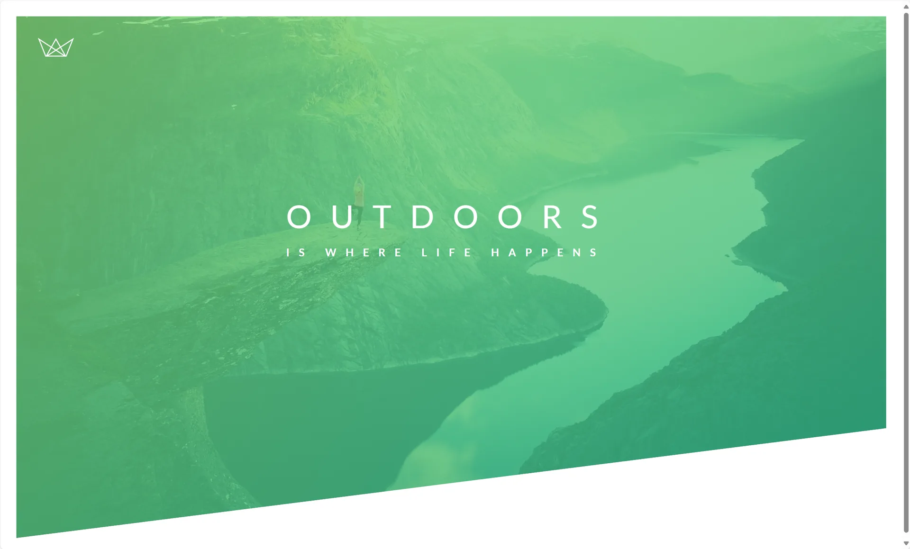
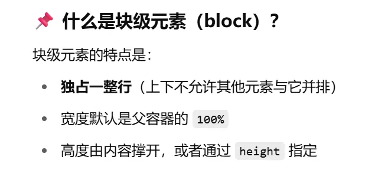

# header主体框架



首先创建一个header标签并且给header加上名为header的选择器

```html
<header class="header">
    <div class="logo-box">
        
    </div>
    <div class="text-box">
        <h1 class="heading-primary">
            <span class="heading-primary-main">Outdoors</span>
            <span class="heading-primary-sub">is where life happens</span>
        </h1>
    </div>

</header>
```

然后再style里面写如下

```css
/* 清除浏览器默认边距 */
* {
    margin: 0;
    padding: 0;
    box-sizing: border-box;
}

/* 页面基础样式设置 */
body {
    font-family: "Lato", sans-serif; /* 设置全局字体 */
    font-weight: 400; /* 字重为正常 */
    font-size: 16px; /* 基础字号 */
    line-height: 1.7; /* 行高，提升文字可读性 */
    color: #777; /* 文字颜色 */
    padding: 30px;
}

.header {
    height: 95vh; /* 高度为视口高度的95% */
    background-image: linear-gradient(
            to right bottom,
            rgba(126, 213, 111, 0.8),
            rgba(40, 180, 133, 0.8)),
    url("../img/hero.jpg"); /* 设置背景图片 */
    background-size: cover;
    background-position: top;
    position: relative;

    clip-path: polygon(0 0, 100% 0, 100% 75vh, 0 100%);
}

```

以下强调一下第一次见的东西

 `font-family: "Lato", sans-serif;`

设置字体优先顺序：

1. 首选 `"Lato"` 字体；
2. 如果没有，就用系统默认的无衬线字体。

`clip-path: polygon(0 0, 100% 0, 100% 75vh, 0 100%);`

这个就是图片每个点的坐标，这个点是顺时针的顺序

然后`background-image`里面的设置`linear-gradient` 是 CSS 中用来创建**线性渐变背景**的函数，它可以让颜色在一个方向上平滑过渡，常用于按钮、背景、边框等美化样式。

```css
background: linear-gradient(direction, color1, color2, ...);
```

再然后就是到了左上角logo还有中间标题的内容

```css
.logo-box {
    position: absolute;
    top: 40px;
    left: 40px;
}

.logo {
    height: 35px;
}

.text-box {
    position: absolute;
    top:40%;
    left: 50%;
    transform: translate(-50%,-50%);//把元素放到中心
}

.heading-primary {
    color: #fff;
    text-transform: uppercase;//文字大写
}

.heading-primary-main {
    display: block;
    font-size: 60px;
    font-weight: 400;
    letter-spacing: 35px;
}

.heading-primary-sub {
    display: block;
    font-size: 20px;
    font-weight: 700;
    letter-spacing: 17.4px;
}
```

首先就是要把logo跟标题分别装到两个`div` 标签里面然后就是新知识点

```css
.header {
    position: relative
}
.logo-box {
    position: absolute;
}
.text-box {
    position: absolute;
    top:40%;
    left: 50%;
    transform: translate(-50%,-50%);
}
```

父容器`header` 是相对位置，子容器`logo-box` 以及`text-box` 是绝对位置然后就是子容器的位置调整

然后先说明一下块级元素`display: block;`



然后就是把容器放到中间的一种办法：

```css
.text-box {
    position: absolute;
    top:40%;
    left: 50%;
    transform: translate(-50%,-50%);//把元素放到中心
}
```

然后下面这个是把logo放到左上角

```css
.logo-box {
    position: absolute;
    top: 40px;
    left: 40px;
}
```