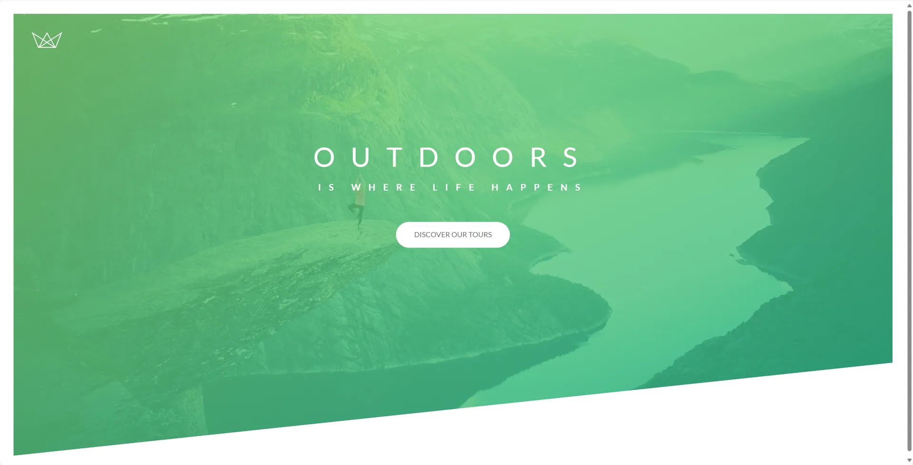
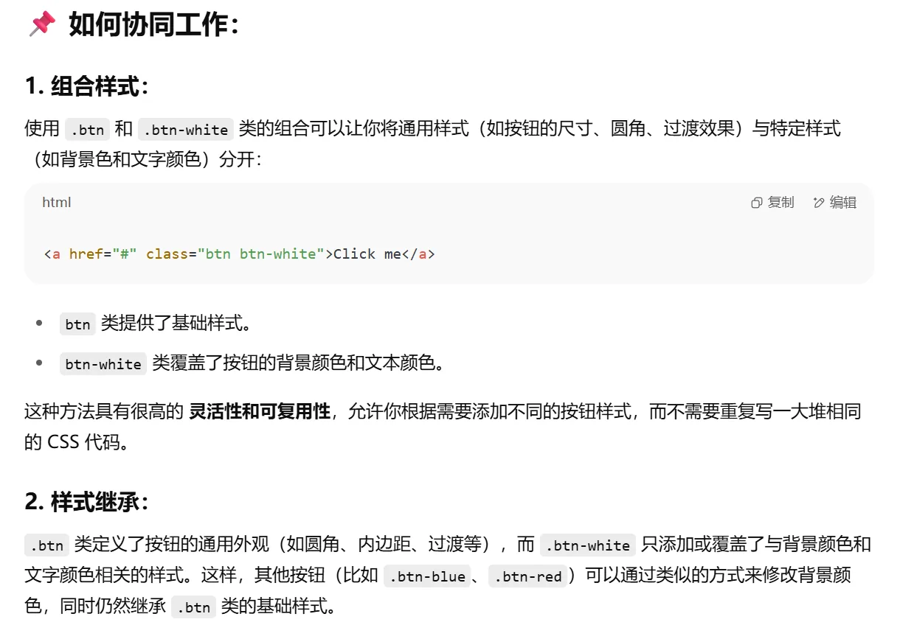
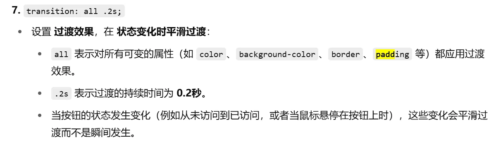

# header动画

现在就把刚刚的标题以及副标题动画效果加上了

```css
.heading-primary-main {
    display: block;
    font-size: 60px;
    font-weight: 400;
    letter-spacing: 35px;

    animation-name: moveInLeft;
    animation-duration: 1s;
    animation-timing-function: ease-out;
    /*
    animation-delay: 3s;
    animation-iteration-count: 3;
    */
}

.heading-primary-sub {
    display: block;
    font-size: 20px;
    font-weight: 700;
    letter-spacing: 17.4px;

    animation-name: moveInRight;
    animation-duration: 1s;
    animation-timing-function: ease-out;
}

@keyframes moveInLeft {
    0% {
        opacity: 0;
        transform: translateX(-100px);
    }

    80% {
        transform: translateX(10px);
    }

    100% {
        opacity: 1;
        transform: translate(0);
    }
}

@keyframes moveInRight {
    0% {
        opacity: 0;
        transform: translateX(100px);
    }

    80% {
        transform: translateX(-10px);
    }

    100% {
        opacity: 1;
        transform: translate(0);
    }
}
```

# 标题动画

`@keyframes` 是 CSS 动画的核心部分，用于定义动画的关键帧。关键帧定义了动画在不同时间点上的样式，从而让浏览器知道如何在动画过程中逐步变化元素的样式。

用法就跟上面一样，`@keyframes` 后面跟动画的名字，然后再两个`span` 标签的类里面定义。`animation` 是 CSS 中用于控制元素动画的属性。通过 `animation` 属性，你可以设置动画的名称、持续时间、播放次数、时间函数、延迟时间等参数。它是 `@keyframes` 动画的快捷方式，用来指定要应用的动画。
也可以简写：

```css
.heading-primary-sub {
    animation: moveInRight 1s ease-out;
}
```

然后就是一定要知道`transform` 的用法

# 按钮样式

然后这个时候需要引入一个新东西，截图代码如下：



```html
<div class="text-box">
    <h1 class="heading-primary">
        <span class="heading-primary-main">Outdoors</span>
        <span class="heading-primary-sub">is where life happens</span>
    </h1>
    <a href="#" class="btn btn-white">Discover our tours</a>
</div>
```

```css
.btn:link,
.btn:visited {
    text-transform: uppercase;//大写
    text-decoration: none;//取消超链接下划线
    padding: 15px 40px;//给超链接元素上下15px，左右40px的内边距
    display: inline-block;//行内块元素
    border-radius: 100px;
    transition: all .2s;
}

.btn:hover {
    transform: translateY(-3px);
    box-shadow: 0 10px 20px rgba(0,0,0,.2);
}

.btn:active {
    transform: translateY(-1px);
    box-shadow: 0 5px 10px rgba(0,0,0,.2);
}

.btn-white {
    background-color: #fff;
    color: #777;
}
```

首先是使用了`btn btn-white` 这种命名方式



着重再说下`transition: all .2s;`



在提一嘴常用的伪类

| 伪类 | 说明 |
| --- | --- |
| `:link` | 未访问的超链接（只适用于 `<a href>`） |
| `:visited` | 访问过的超链接 |
| `:hover` | 鼠标悬停时 |
| `:active` | 鼠标点击时 |
| `:focus` | 元素获得焦点时（比如点击或 tab 键） |

最后还有`box-shadow: 0 5px 10px rgba(0,0,0,.2);`的意思

- 增加了一个 **阴影效果**，让按钮在悬停时更加突出。
- `0 10px 20px`：代表阴影的偏移量和模糊程度。`rgba(0,0,0,.2)` 是阴影的颜色，黑色且透明度为 20%。

这个鼠标的唯一逻辑就是移动到上面的时候就会位移-3px然后给出一个较大的阴影，当点下去的时候会位移-1px并且会给出一个比较小的阴影就这样

补充一下`opacity: 0;` 是 CSS 中的一个属性，用来设置元素的 **透明度**。它控制元素的可见程度，值范围从 `0` 到 `1`，

# 按钮动画

然后比较重要的来了，引入了伪元素，这个跟伪类不是一种东西

| 特点 | **伪类（Pseudo-class）** | **伪元素（Pseudo-element）** |
| --- | --- | --- |
| **定义** | 选取元素的 **特定状态**，如鼠标悬停、焦点等 | 选取元素的 **特定部分** 或 **生成虚拟元素** |
| **用法** | 通常表示元素的 **动态状态**（如 :hover、:focus） | 用于为元素 **插入虚拟内容** 或样式化元素的部分 |
| **选择器语法** | 使用单冒号 `:`，如 `:hover`、`:focus` | 使用双冒号 `::`，如 `::before`、`::after` |
| **常见示例** | `a:hover`、`input:focus`、`:nth-child(1)` | `div::before`、`p::first-letter`、`::after` |
| **是否真实存在于 DOM 中** | 元素的状态是动态的，与 DOM 中的真实元素相关联 | 伪元素不在 DOM 中，只是 CSS 中的虚拟内容 |
| **作用范围** | 控制 **元素状态**，如鼠标悬停、选中等 | 控制 **元素的部分内容** 或为元素插入内容 |

```css
.btn::after {
    content: "";
    display: inline-block;
    height: 100%;
    width: 100%;
    border-radius: 100px;
    position: absolute;
    top: 0;
    left: 0;
    z-index: -1;
    transition: all .4s;
}

.btn-white::after {
    background-color: #fff;
}

.btn:hover::after {
    transform: scaleX(1.4) scaleY(1.6);
    opacity: 0;
}

@keyframes moveInBottom {
    0% {
        opacity: 0;
        transform: translateY(30px);
    }

    100% {
        opacity: 1;
        transform: translate(0);
    }
}

.btn-animated {
    animation: moveInBottom .5s ease-out .75s;
    animation-fill-mode: backwards;
}
```

首先就是给按钮新加了一个类

```html
<a href="#" class="btn btn-white btn-animated">Discover our tours</a>
```

这下动画绑定在这个新类上，还有一个需要注意的是这个按钮的动画会延迟0.75s再触发并且必须要用`animation-fill-mode: backwards;` 这样的话当动画还没有开始时，元素会呈现动画的起始状态。一旦动画开始，它会按照预定的关键帧进行动画。

接下来引入伪元素after必须要有content哪怕为空，不然伪元素不显示，定位就是绝对位置所以也要给父元素加上相对位置

```css
.btn:link,
.btn:visited {
    position: relative;
}
```

在接下来给好位置，让图层显示到元素的下面，再给出颜色，以及鼠标移动到上面的变化效果，这三个都是跟原本的类一一对应的，最终再给hover一个淡入淡出的效果就实现功能了

最终效果如下

