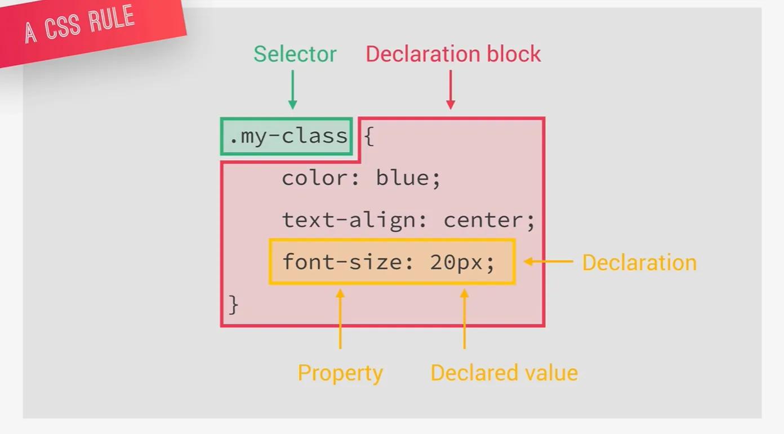

# 重要的讲座

# web开发三要素

1. 响应式设计 
2. 编写可维护和可扩展的代码
3. 网络性能

# CSS发生了什么？

加载一个网页的时候CSS发生了什么？

从加载HTML，解码HTML，到浏览器构造DOM对象

CSS在解码HTML的时候就开始加载然后解码但是这个解码过程很麻烦

主要有两个阶段

1. 级联：解决CSS冲突问题
2. 处理最终的CSS值

处理完这两个之后最终的CSS也存储在树状结构中成为CSS对象模型（CSSOM），类似于DOM。最终CSSOM和DOM形成了所谓的渲染树

为了呈现画面，浏览器使用一种叫做视觉格式化模型，比如盒子模型、浮动和定位，然后呈现出画面

## CSS解析阶段

