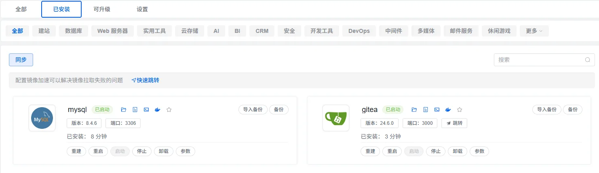
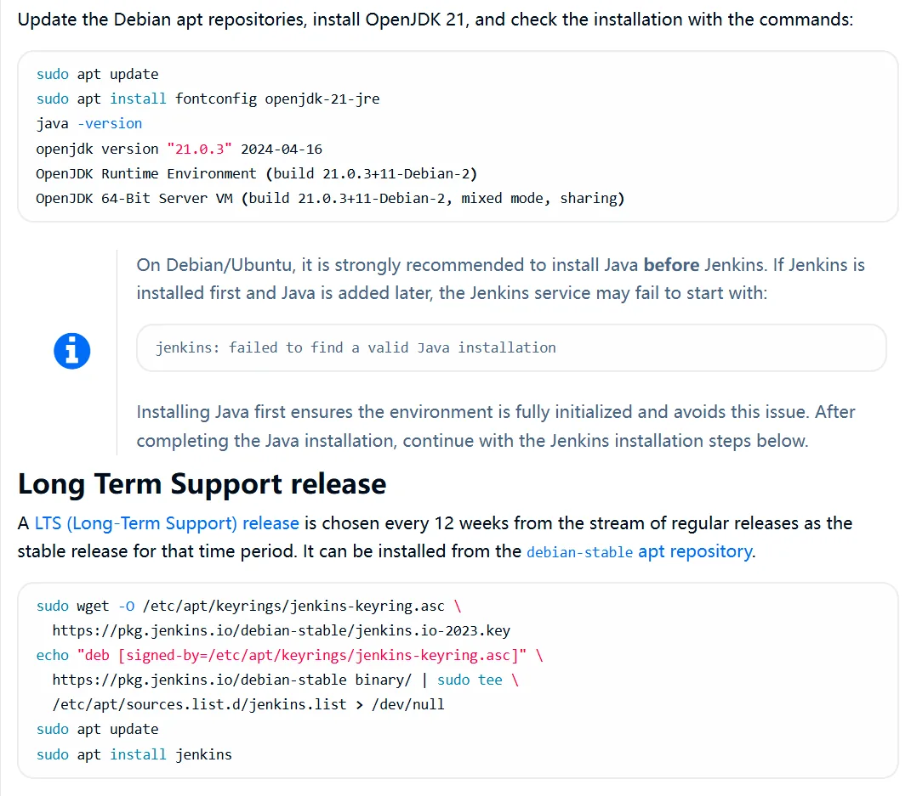
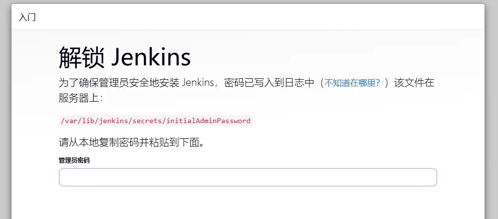
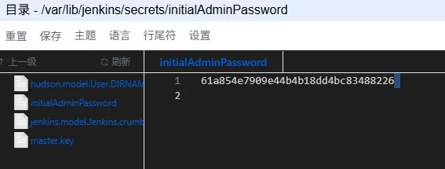
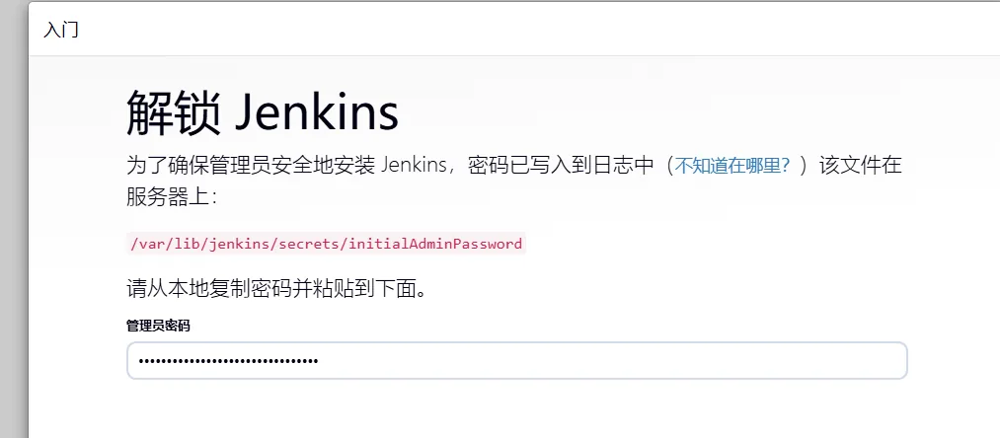
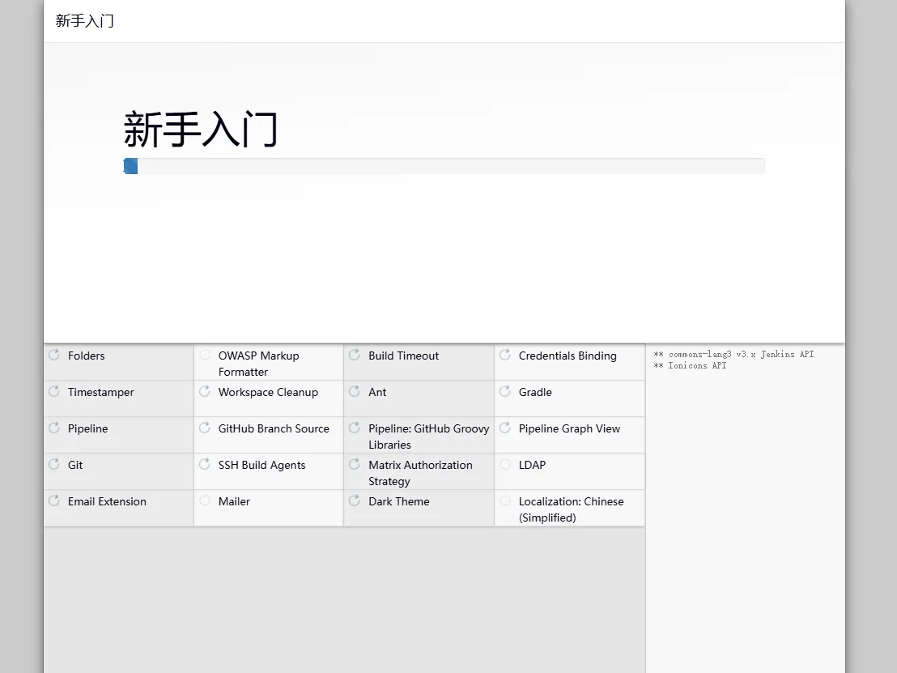
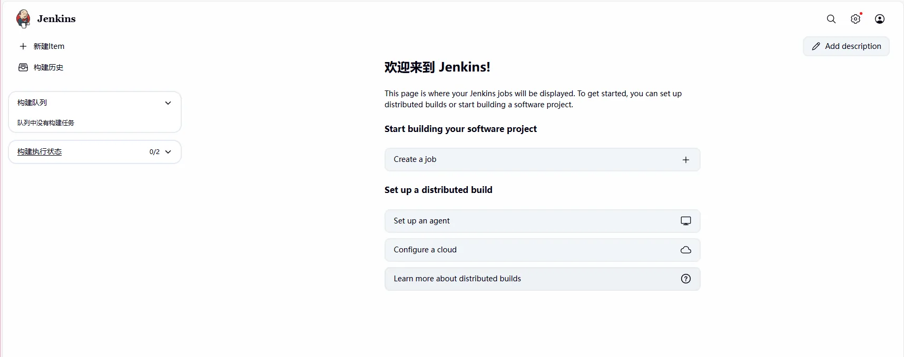

# Gitea + Jenkins实现CI/CD

也是折腾了一天现在来写一个教学,教学用的环境就是Ubuntu24的Server版

至少要有个4g的内存不然别来沾边,2c2g是跑不起来的

拿到初始环境就是两件套命令

```bash
sudo apt update && apt upgrade
```

原生安装太麻烦了为了图方便我们用1panel面板来安装

```bash
sudo bash -c "$(curl -sSL https://resource.fit2cloud.com/1panel/package/v2/quick_start.sh)"
```

然后就是喜闻乐见的安装面板过程就省略了直接快进到面板安装完毕服务启动

```bash
[1Panel Log]: 正在启动 1Panel 服务 
[1Panel Log]: 1Panel 服务已成功启动，正在继续执行后续配置，请稍候... 
[1Panel Log]:  
[1Panel Log]: =================感谢您的耐心等待，安装已完成================== 
[1Panel Log]:  
[1Panel Log]: 请使用您的浏览器访问面板:  
[1Panel Log]: 外部地址:  http://113.17.214.172:41478/seven 
[1Panel Log]: 内部地址:  http://192.168.37.128:41478/seven 
[1Panel Log]: 面板用户:  seven 
[1Panel Log]: 面板密码:  seven777 
[1Panel Log]:  
[1Panel Log]: 官方网站: https://1panel.cn 
[1Panel Log]: 项目文档: https://1panel.cn/docs 
[1Panel Log]: 代码仓库: https://github.com/1Panel-dev/1Panel 
[1Panel Log]: 前往 1Panel 官方论坛获取帮助: https://bbs.fit2cloud.com/c/1p/7 
[1Panel Log]:  
[1Panel Log]: 如果您使用的是云服务器，请在安全组中打开端口 41478 
[1Panel Log]:  
[1Panel Log]: 为了您的服务器安全，离开此屏幕后您将无法再次看到您的密码，请记住您的密码。 
[1Panel Log]:  
[1Panel Log]: ================================================================ 

```

然后我们在自己电脑中打开这个内部网址即可http://192.168.37.128:41478/seven 

接下来我们再1panel商店中安装以下软件即可



然后接下来的jenkins我们在这里不使用1panel的应用商店来安装jenkins

理论上来说是完全可行的设置挂载目录即可但是有点麻烦所以我们这里使用原生安装的方式

所以我们进入jenkins官网查看安装,找到Ubuntu的安装地方

需要注意的是我们需要先安装openjdk因为jenkins安装需要java环境

版本我这里选择17因为我自己的项目是用这个跑的

```bash
sudo apt install fontconfig openjdk-17-jre
java -version
```

```bash
cmcy@cmcy:~$ java -version
openjdk version "17.0.16" 2025-07-15
OpenJDK Runtime Environment (build 17.0.16+8-Ubuntu-0ubuntu124.04.1)
OpenJDK 64-Bit Server VM (build 17.0.16+8-Ubuntu-0ubuntu124.04.1, mixed mode, sharing)
```

openjdk17安装成功继续安装jenkins

```bash
sudo wget -O /etc/apt/keyrings/jenkins-keyring.asc \
  https://pkg.jenkins.io/debian-stable/jenkins.io-2023.key
echo "deb [signed-by=/etc/apt/keyrings/jenkins-keyring.asc]" \
  https://pkg.jenkins.io/debian-stable binary/ | sudo tee \
  /etc/apt/sources.list.d/jenkins.list > /dev/null
sudo apt update
sudo apt install jenkins
```

这是在官网拷贝下来的如下,别说我骗你



默认情况下端口是在8080,所以我们去8080端口下查看即可

[http://192.168.37.128:8080/](http://192.168.37.128:8080/)



然后此时我们到1panel面板的系统/文件管理去查看这个密码到底是多少



然后就是CV进去就可以



点击继续即可,然后安装推荐插件即可,因为我也不懂到底需要那些插件

没错因为我也是第一次搞我也不太懂,老实等装完吧



然后就是填写你的基本信息之后就会来到jenkins的web页面

