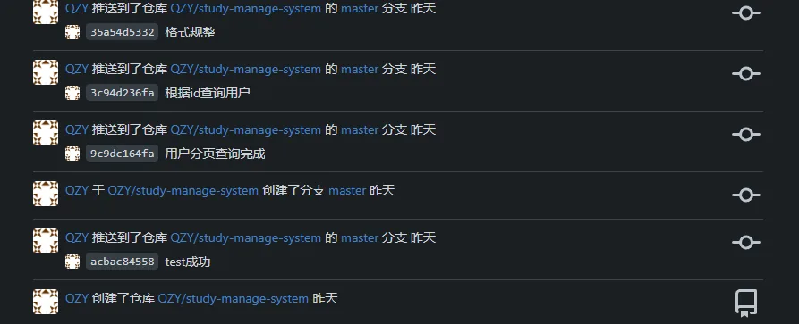
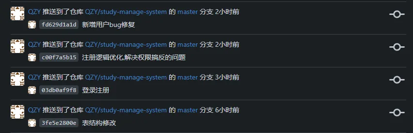
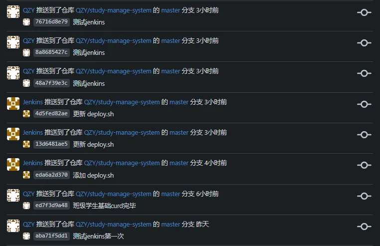

# 学情管理系统

# 前言

矫情一点废话吧,前两天才被狗咬了一口真的烦,或许有的时候我就应该对别人更加刻薄一点

言归正传,这个学情管理系统很久之前就已经提过了,但是我当时只懂点前端,后端还没有接触到框架层面,所以当时就只能不了了之

当时以及后来一段时间我也暂时没打算学java后端,但我去学nodejs跟nestjs框架,想用这个来写后端,后来也是因为一些莫名其妙的报错选择放弃了nestjs,而且此时正值大二升大三的暑假,在家里学基本就是学学歇歇玩玩,效率跟专注度也远没有在学校这么高

开学之后只是想着好好精进下自己的前端水平,当时有过想学nuxt3这种应用框架开发,但是真正接触的时候发现这东西也是有很多问题我现在解决不了或者说解决起来是有困难的,所以我就转过头去学一个老外的react教程,也算学到了一些东西,比如组件通信还有fibertree啥的,当时每天脑子里都在思考各种前端的概念,因为在此之前我学的前端都是不加思考的学,500p的视频看了200p

转机就在这里,因为不太懂url控制前端页面显示内容所以我一怒之下就去学了javaweb的后端课程,其实现在想想似乎跟写后端也没啥关系,结果学起来发现后端也没那么难,Springboot一些基础的东西还是比较好学懂的,就是一些逻辑确实是需要自己好好思考的,以后学东西坚决不能无脑学了,还是得投入时间与精力去学

在我把苍穹外卖结束的时候刚好毛睿老师开了次会说这个学情管理系统,也不能说我已经神功大成了,但是也算是全栈入门了,微服务这一块还没学过

而且身边认识的人也没几个喜欢学开发的,暂时做这件事基本也就是我一个人,别的人目前也帮不了多少忙,就当锻炼一下自己吧,那便战吧

# 2025-10-18

今天才开始写,前天也就是2025-10-16中午开的会,会后我又跟程义杰多讨论了一下到底怎么搞Excel导入的问题,然后我下午过来就自己大概构思了一下数据库的雏形,又干了点别的但是忘了是在干啥了,然后这就到晚上七点了我去观音山305去跟申恩涛讨论了两个多小时数据库的东西还有给他讲一下开发环境的事情

昨天也就是2025-10-17,我又思考了一会把表结构v1建好了然后就是项目工程化的一些准备,本来打算搞gitlab后来发现我服务器内存不太够最后搞了gitea,这个倒是十分的轻量,然后就是建了一个测试表写了一个测试接口搭建了项目的基本骨架目录,晚上又把用户管理部分的curd写了一下

后来捣鼓了一下看看怎么搞CI/CD结果一方面是gitea在容器里面runner跑不出去然后就是我服务器的内存不太够,这么一来我可能不得不加大一下空间了,目前想着是用jenkins

今天早上跟毛睿老师讨论了一下表的具体细则中午下午一共修改了两版现在是表结构v3

加密密码,登录注册,权限问题解决了,以后开发可能会轻松一点点

然后接下来我打算把jenkins搞一下,作为一个想掌握全部工具链的人我还是想搞一下CI/CD的

# 2025-10-19

昨晚跟今天下午的好几个小时都在研究怎么CI/CD虽然现在也是一知半解但是总算是把一套流程做完了,从把代码推送到gitea开始,jenkins检测到变化然后执行构建任务,构建完了之后执行预先写好的脚本,这块内容比较多改天我会单独写一篇出来的

然后就是今天的代码进度,其实没多少

写了两张表的curd然后剩下时间都在捣鼓怎么搞CI/CD好在是最后终于成功了,今天的表到了v4

- [Gitea + Jenkins实现CI/CD](Gitea与Jenkins实现CI-CD.md)
