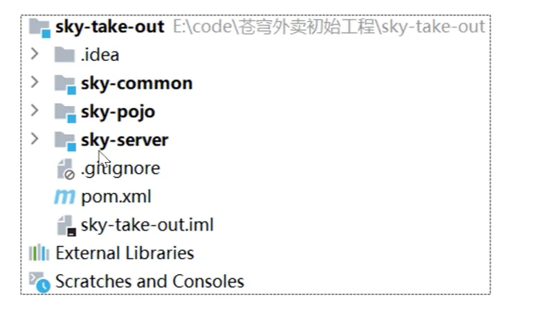
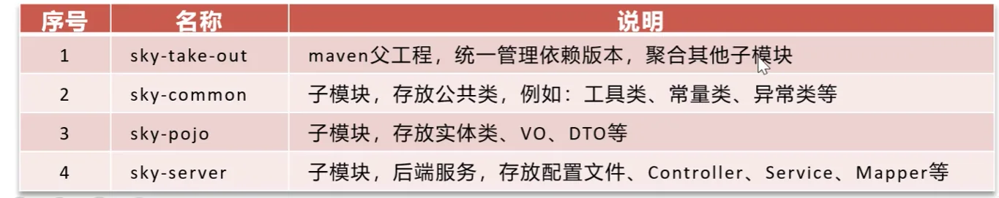
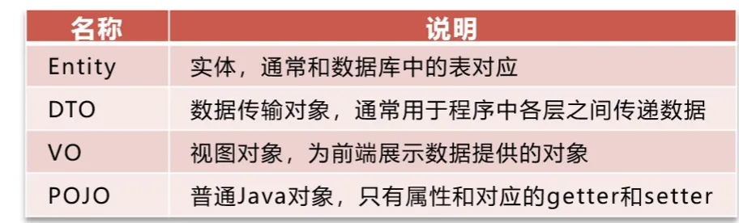
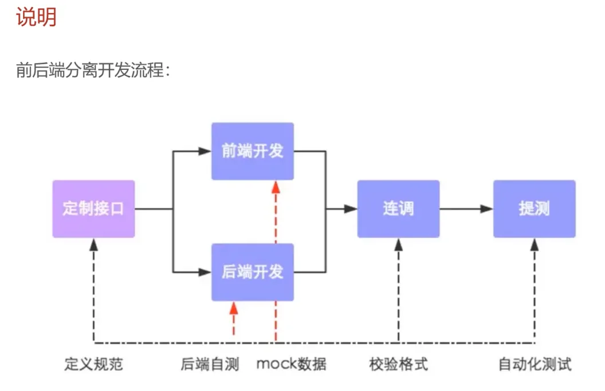
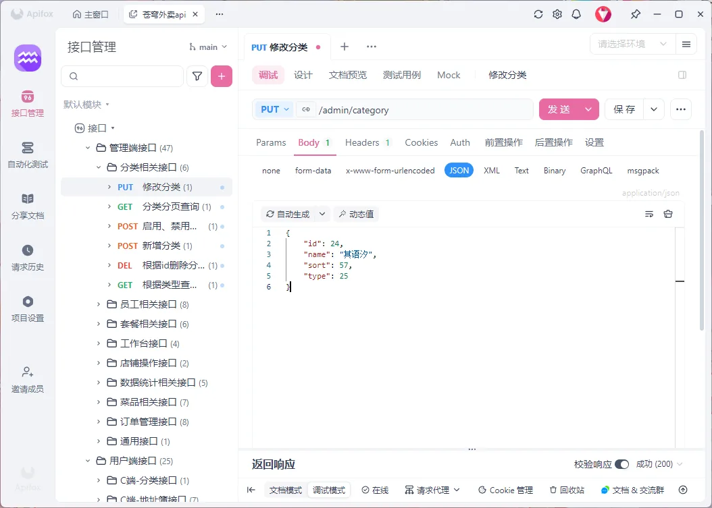
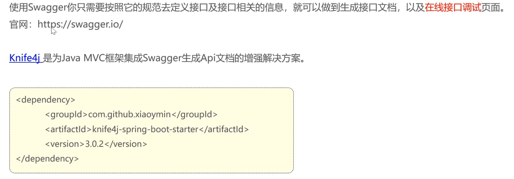

# day-01


## 本日目录

- [01-软件开发整体介绍](#_01-软件开发整体介绍)
- [02-苍穹外卖项目介绍](#_02-苍穹外卖项目介绍)
- [03-开发环境搭建](#_03-开发环境搭建)
- [04-导入接口文档](#_04-导入接口文档)
- [05-Swagger](#_05-swagger)

## 01-软件开发整体介绍

## 1.软件开发流程

### 需求分析

- 需求规格说明书
- 产品原型

### 设计

- UI设计
- 数据库设计
- 接口设计

### 编码

- 项目代码
- 单元测试

### 测试

- 测试用例
- 测试报告

### 上线运维

- 软件环境安装
- 配置

## 2.角色分工

### 项目经理

对整个项目负责,任务分配,把控进度

### 产品经理

进行需求调研,输出需求调研文档,产品原型等

### UI设计师

根据产品原型输出界面效果图

### 架构师

项目整体架构设计,技术选型等

### 开发工程师

代码实现

### 测试工程师

编写测试用例,输出测试报告

### 运维工程师

软件环境搭建,项目上线

## 3.软件环境

### 开发环境(development)

开发人员在开发阶段使用的环境,一般外部用户无法访问

### 测试环境(testing)

专门给测试人员使用的环境,用于测试项目,一般外部用户无法访问

### 生产环境(production)

即线上环境,正式提供对外服务的环境

## 02-苍穹外卖项目介绍

## 1.项目介绍

### 定位

专门为餐饮企业(餐厅,饭店)定制的一款软件产品

- 管理端 - 外卖商家使用
- 用户端 - 点餐用户使用

### 功能架构

1. 管理端
    - 员工管理
    - 分类管理
    - 菜品管理
    - 套餐管理
    - 订单管理
    - 工作台
    - 数据统计
    - 来单提醒
2. 用户端
    - 微信登录
    - 商品浏览
    - 购物车
    - 用户下单
    - 微信支付
    - 历史订单
    - 地址管理
    - 用户催单

## 2.产品原型

### 产品原型

用于展示项目的业务功能,一般由产品经理进行设计

## 3.技术选型

1. 用户层
    - Node.js
    - Vue.js
    - element plus
    - 微信小程序
    - apache echarts
2. 网关层
    - Nginx
3. 应用层
    - Springboot
    - SpringMvc
    - Spring Task
    - httpclient
    - Spring Cache
    - JWT
    - 阿里云OSS
    - Swagger
    - POI
    - WebSocket
4. 数据层
    - MySQL
    - Redis
    - mybatis
    - pagehelper
    - spring data redis
5. 工具
    - Git
    - maven
    - Junit
    - postman

## 03-开发环境搭建

## 1.前端环境搭建

因为这个苍穹外卖主要是后端的项目所以前端代码就是直接写好的 

到提供的资料里面把ngnix拖到没有中文路径的地方然后直接双击启动访问localhost:80即可

## 2.后端环境搭建

### 大的目录结构







### Git仓库创建

这个没什么好说的都是些老生常谈的东西就是git init然后git remote add origin `<url>`

再然后git push -u origin master推送上去差不多都是这样的

### 数据库环境搭建

这个就是使用他提供的sql文件然后你自己把这个文件复制粘贴到DataGrip里面然后一键执行即可

### 前后端联调测试

依旧是访问localhost:80然后直接登录即可,这里需要强调的就是你需要到项目中的application-dev.yml文件里面修改一下datasource的配置

然后现在测试一下登录功能发现已经登录成功了

## 3.完善登录功能

问题 : 员工表中的密码是明文存储,安全性太低,思路如下:

- 将密码加密后存储,提高安全性
- 使用MD5加密方式对明文密码加密

经过前后端联调测试之后我们打断点debug找到密码比对部分

然后首先需要对原本数据库中的employee表中的admin的password修改成加密后的

- 原本的:123456
- 加密后的e10adc3949ba59abbe56e057f20f883e

这一块的加密代码还是CV的b站弹幕

### EmployeeServiceImpl

只需要在判断密码跟数据库中是否相等这一块的上面重新对password赋值为MD5加密后的密文然后再与数据库中的密文进行对比

```java
password = DigestUtils.md5DigestAsHex(password.getBytes());
if (!password.equals(employee.getPassword())) {
    //密码错误
    throw new PasswordErrorException(MessageConstant.PASSWORD_ERROR);
}
```

最后在前后端联调测试一下登录是否成功

## 04-导入接口文档

## 前后端分离开发流程



## 操作步骤

然后就不得不说一下这里的接口文档是怎么导入的了

资料当中给了两个json接口文档是YApi的格式

然后在apifox里面创建一个空项目起名字为苍穹外卖然后在根目录创建两个目录一个命名为管理端接口另一个是用户端接口然后分别在这两个文件夹下导入对应的json文件导入方式就是YApi然后就能拿到完整的接口文档了



## 05-Swagger

说实话apifox太牛逼了导致这玩意完全没用,正确的中肯的一针见血的✍️✍️✍️✍️

## 介绍



## 使用方式

1. 导入knife4j的maven坐标
2. 在配置类中加入knife4j相关配置
3. 设置静态资源映射,否则接口文档页面无法访问

在这个准备好的项目代码里面其实就是运行起来之后直接访问localhost:8080/doc.html即可
