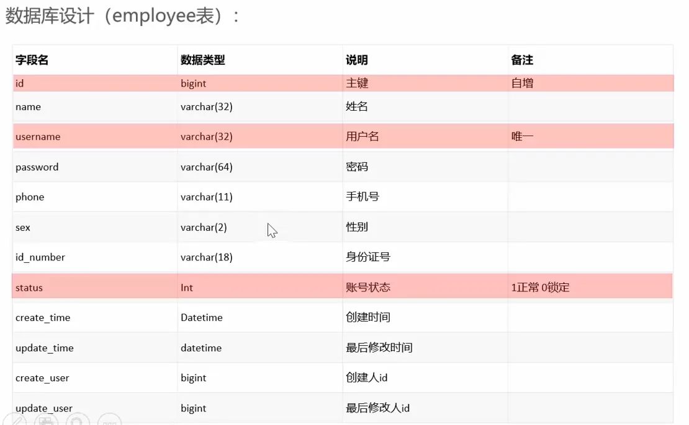
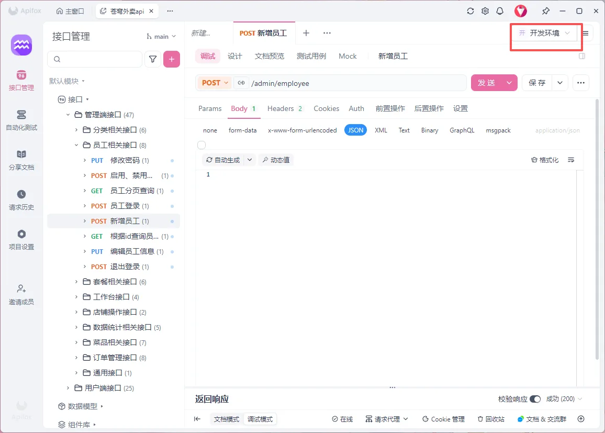
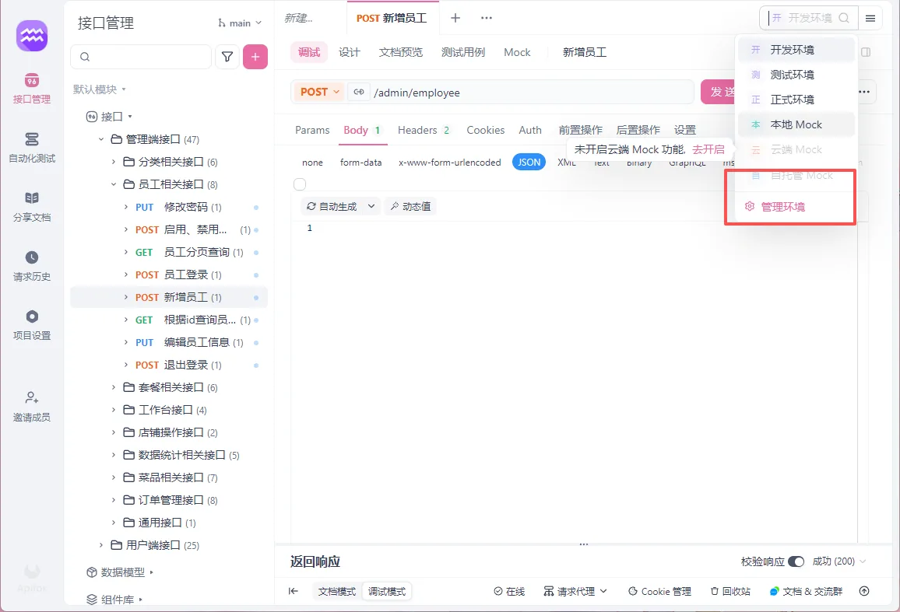
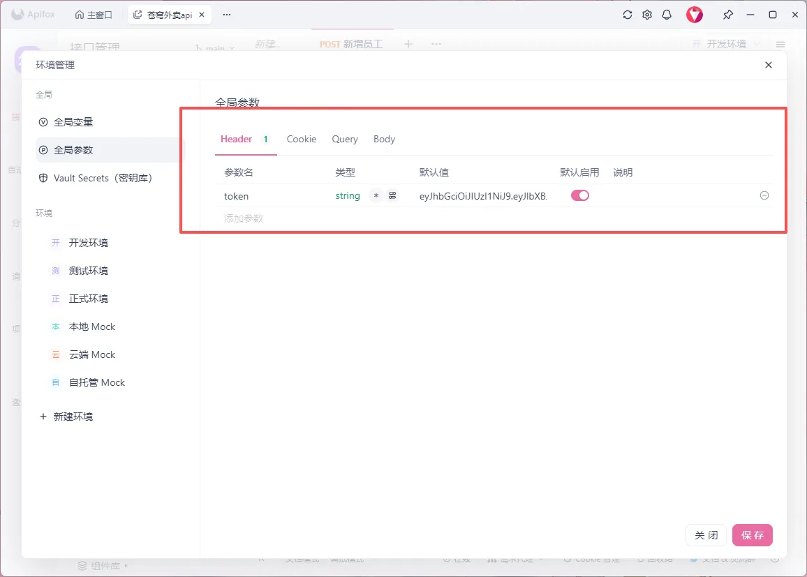
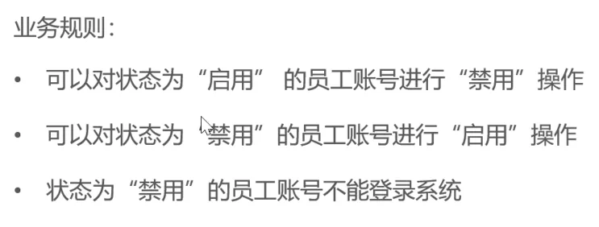
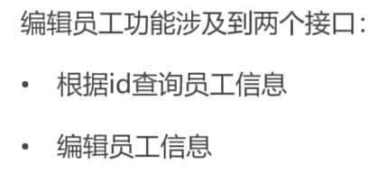
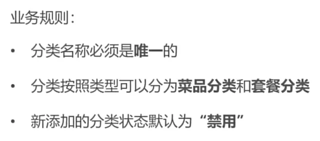

# day-02


## 本日目录

- [01-新增员工](#_01-新增员工)
- [02-员工分页查询](#_02-员工分页查询)
- [03-启用禁用员工账号](#_03-启用禁用员工账号)
- [04-编辑员工](#_04-编辑员工)
- [05-导入分类模块功能代码](#_05-导入分类模块功能代码)

## 01-新增员工

## 需求分析和设计

本项目约定:

- **管理端**发出的请求,统一使用/admin作为前缀
- **用户端**发出的请求,统一使用/user作为前缀

### 数据库设计



## 代码实现

相较于之前的javaweb+ai的课程这里使用了DTO也就是数据传输对象来封装请求

其实之前也有QueryParam这类型的但跟这个不一样那个是专门封装Get请求参数的而现在这个是Post请求

所以这里就是用@RequestBody来接收前端传过来的json然后再把这个DTO对象传入Service层

进入Service层之后在使用对象属性拷贝将传入的DTO对象赋值给new出来的原对象然后再在下面对new出来的对象进行赋值然后就是调用mapper传入到mapper里面

### Controller

```java
@PostMapping
@ApiOperation("新增员工")
public Result save(@RequestBody EmployeeDTO employeeDTO) {
    log.info("新增员工:{}", employeeDTO);
    employeeService.save(employeeDTO);
    return Result.success();
}
```

### Service

```java
void save(EmployeeDTO employeeDTO);
```

```java
@Override
public void save(EmployeeDTO employeeDTO) {
    Employee employee = new Employee();
    //对象属性拷贝
    BeanUtils.copyProperties(employeeDTO, employee);
    //设置账号的状态
    employee.setStatus(StatusConstant.ENABLE);
    employee.setPassword(DigestUtils.md5DigestAsHex(PasswordConstant.DEFAULT_PASSWORD.getBytes()));
    employee.setCreateTime(LocalDateTime.now());
    employee.setUpdateTime(LocalDateTime.now());
    //TODO
    employee.setCreateUser(10L);
    employee.setUpdateUser(10L);
    employeeMapper.insert(employee);
}
```

### Mapper

```java
@Insert("insert into employee (name, username, password, phone, sex, id_number, create_time, update_time, create_user, update_user) " +
        "values" +
        "(#{name},#{username},#{password},#{phone},#{sex},#{idNumber},#{createTime},#{updateTime},#{createUser},#{updateUser})")
void insert(Employee employee);
```

## apifox全局环境变量设置

因为每次请求都必须要带上jwt令牌认证所以就在这里全局配置一下header里面的token为jwt令牌







## 异常处理

重复添加就会报这个类型的错误SQLIntegrityConstraintViolationException

然后我们获取报错并对这个字符串做分隔处理最后给前端返回报错

```java
@ExceptionHandler
public Result exceptionHandler(SQLIntegrityConstraintViolationException ex){
    String message = ex.getMessage();
    if(message.contains("Duplicate entry")){
        String[] split = message.split(" ");
        String username = split[2];
        String msg = username + "用户名已存在";
        return Result.error(msg);
    }else {
        return Result.error(MessageConstant.UNKNOWN_ERROR);
    }
```

## 使用新增员工时的操作

这块需要在拦截器里面校验令牌的地方调用`BaseContext.*setCurrentId*(empId)**;`** 

然后再在Service实现类里面修改

```java
employee.setCreateUser(BaseContext.getCurrentId());
employee.setUpdateUser(BaseContext.getCurrentId());
```

然后这里的BaseContext如下

```java
package com.sky.context;

public class BaseContext {

    public static ThreadLocal<Long> threadLocal = new ThreadLocal<>();

    public static void setCurrentId(Long id) {
        threadLocal.set(id);
    }

    public static Long getCurrentId() {
        return threadLocal.get();
    }

    public static void removeCurrentId() {
        threadLocal.remove();
    }

}
```

**ThreadLocal用于线程安全的上下文传递**

这段代码使用`ThreadLocal`是为了在多线程Web应用中安全地存储和传递用户ID等上下文信息。每个线程（通常对应一个HTTP请求）都有自己独立的变量副本，避免了线程间数据干扰，无需同步机制就能实现线程安全。这样可以在整个请求处理过程中方便地获取当前用户ID，而不需要在每个方法间传递参数，是Web开发中常见的上下文管理模式。

## 02-员工分页查询

## 代码实现

### Controller

这里需要注意的是泛型PageResult以及最后返回传入的类型也是PageResult

```java
@GetMapping("/page")
@ApiOperation("员工分页查询")
public Result<PageResult> page(EmployeePageQueryDTO employeePageQueryDTO) {
    log.info("员工分页查询:{}", employeePageQueryDTO);
    PageResult pageResult = employeeService.pageQuery(employeePageQueryDTO);
    return Result.success(pageResult);
}
```

### Service

```java
PageResult pageQuery(EmployeePageQueryDTO employeePageQueryDTO);
```

使用PageHelper来实现分页

首先调用PageHelper中的静态方法startPage传入DTO中的page参数跟pagesize参数

然后调用Mapper方法将结果保存到PageHelper提供的Page类

再调用Page类中的getTotal跟getResult方法使用变量保存起来最终返回一个new出来的PageResult对象

```java
@Override
public PageResult pageQuery(EmployeePageQueryDTO employeePageQueryDTO) {
    PageHelper.startPage(employeePageQueryDTO.getPage(),employeePageQueryDTO.getPageSize());
    Page<Employee> page = employeeMapper.pageQuery(employeePageQueryDTO);
    long total = page.getTotal();
    List<Employee> records = page.getResult();
    return new PageResult(total,records);
}
```

### Mapper

模糊搜索name

```java
Page<Employee> pageQuery(EmployeePageQueryDTO employeePageQueryDTO);
```

```xml
<select id="pageQuery" resultType="com.sky.entity.Employee">
    select * from employee
    <where>
        <if test="name != null and name != ''">
            and name like concat('%',#{name},'%')
        </if>
    </where>
    order by create_time desc
</select>
```

## Jwt令牌过期问题解决

用着用着发现刚刚在apifox里面全局配置失效了于是我直接找到工具类JwtUtil

```java
// 设置jwt的body
JwtBuilder builder = Jwts.builder()
        // 如果有私有声明，一定要先设置这个自己创建的私有的声明，这个是给builder的claim赋值，一旦写在标准的声明赋值之后，就是覆盖了那些标准的声明的
        .setClaims(claims)
        // 设置签名使用的签名算法和签名使用的秘钥
        .signWith(signatureAlgorithm, secretKey.getBytes(StandardCharsets.UTF_8));
        // 设置过期时间
        //.setExpiration(exp);
```

把这里的setExpiration(exp)注释掉即可,这样令牌就是永久的了或者是不注释这个去application.yml去修改配置

## 统一日期格式

在这里传给前端的日期格式没有格式化有一定的问题导致显示的不好看所以需要修改传递的格式

### Employee

```java
@JsonFormat(pattern = "yyyy-MM-dd HH:mm:ss")
private LocalDateTime createTime;
@JsonFormat(pattern = "yyyy-MM-dd HH:mm:ss")
private LocalDateTime updateTime;
```

加上@JsonFormat(pattern = "yyyy-MM-dd HH:mm:ss")统一格式即可,但是这样还得一个一个配置所以就有了下面的全局配置

### WebMvcConfiguration

```java
@Override
protected void extendMessageConverters(List<HttpMessageConverter<?>> converters) {
    log.info("扩展消息转换器");
    //创建一个消息转换器对象
    MappingJackson2HttpMessageConverter converter = new MappingJackson2HttpMessageConverter();
    //需要为消息转换器设置一个对象转换器，对象转化器可以将java对象序列化为json数据
    converter.setObjectMapper(new JacksonObjectMapper());
    //将自己的消息转换器加入到容器中
    converters.add(0,converter);
}
```

这里的`converter.setObjectMapper(new JacksonObjectMapper());`的作用就是把我们自己定义的对象转换器传递进来

```java
package com.sky.json;

import com.fasterxml.jackson.databind.DeserializationFeature;
import com.fasterxml.jackson.databind.ObjectMapper;
import com.fasterxml.jackson.databind.module.SimpleModule;
import com.fasterxml.jackson.datatype.jsr310.deser.LocalDateDeserializer;
import com.fasterxml.jackson.datatype.jsr310.deser.LocalDateTimeDeserializer;
import com.fasterxml.jackson.datatype.jsr310.deser.LocalTimeDeserializer;
import com.fasterxml.jackson.datatype.jsr310.ser.LocalDateSerializer;
import com.fasterxml.jackson.datatype.jsr310.ser.LocalDateTimeSerializer;
import com.fasterxml.jackson.datatype.jsr310.ser.LocalTimeSerializer;

import java.time.LocalDate;
import java.time.LocalDateTime;
import java.time.LocalTime;
import java.time.format.DateTimeFormatter;

import static com.fasterxml.jackson.databind.DeserializationFeature.FAIL_ON_UNKNOWN_PROPERTIES;

/**
 * 对象映射器:基于jackson将Java对象转为json，或者将json转为Java对象
 * 将JSON解析为Java对象的过程称为 [从JSON反序列化Java对象]
 * 从Java对象生成JSON的过程称为 [序列化Java对象到JSON]
 */
public class JacksonObjectMapper extends ObjectMapper {

    public static final String DEFAULT_DATE_FORMAT = "yyyy-MM-dd";
    //public static final String DEFAULT_DATE_TIME_FORMAT = "yyyy-MM-dd HH:mm:ss";
    public static final String DEFAULT_DATE_TIME_FORMAT = "yyyy-MM-dd HH:mm";
    public static final String DEFAULT_TIME_FORMAT = "HH:mm:ss";

    public JacksonObjectMapper() {
        super();
        //收到未知属性时不报异常
        this.configure(FAIL_ON_UNKNOWN_PROPERTIES, false);

        //反序列化时，属性不存在的兼容处理
        this.getDeserializationConfig().withoutFeatures(DeserializationFeature.FAIL_ON_UNKNOWN_PROPERTIES);

        SimpleModule simpleModule = new SimpleModule()
                .addDeserializer(LocalDateTime.class, new LocalDateTimeDeserializer(DateTimeFormatter.ofPattern(DEFAULT_DATE_TIME_FORMAT)))
                .addDeserializer(LocalDate.class, new LocalDateDeserializer(DateTimeFormatter.ofPattern(DEFAULT_DATE_FORMAT)))
                .addDeserializer(LocalTime.class, new LocalTimeDeserializer(DateTimeFormatter.ofPattern(DEFAULT_TIME_FORMAT)))
                .addSerializer(LocalDateTime.class, new LocalDateTimeSerializer(DateTimeFormatter.ofPattern(DEFAULT_DATE_TIME_FORMAT)))
                .addSerializer(LocalDate.class, new LocalDateSerializer(DateTimeFormatter.ofPattern(DEFAULT_DATE_FORMAT)))
                .addSerializer(LocalTime.class, new LocalTimeSerializer(DateTimeFormatter.ofPattern(DEFAULT_TIME_FORMAT)));

        //注册功能模块 例如，可以添加自定义序列化器和反序列化器
        this.registerModule(simpleModule);
    }
}
```

这样传递的格式就全局格式化了

## 03-启用禁用员工账号

## 需求分析和设计



## 代码实现

这一块的实现思路就是使用一个update员工信息的Mapper接口然后来根据传入的id查找员工并修改员工的status

这里的Mapper接口中的update方法可以修改任意的员工信息并不局限于status

### Controller

```java
@PostMapping("/status/{status}")
@ApiOperation("启动禁用员工账号")
public Result startOrStop(@PathVariable Integer status,Long id) {
    log.info("启用禁用员工账号:{},{}",status,id);
    employeeService.startOrStop(status,id);
    return Result.success();
}
```

### Service

```java
void startOrStop(Integer status, Long id);
```

```java
@Override
public void startOrStop(Integer status, Long id) {
    //Employee employee = new Employee();
    //employee.setStatus(status);
    //employee.setId(id);
    Employee employee = Employee.builder().id(id).status(status).build();
    employeeMapper.update(employee);
}
```

这一块有两种传入参数的方式一种是通过set方法来赋值一种是使用builder模式来进行赋值

使用builder进行赋值需要在Employee类中使用@Builder装饰器这个装饰器是**Lombok引入的**

### Mapper

这块就加深一下对于update的印象

update加上表名

然后下面使用动态sql的写法来判断更新哪些内容

最后where来选定更新的对象

```java
void update(Employee employee);
```

```xml
<update id="update">
        update employee
        <set>
            <if test="name != null">
                name = #{name},
            </if>
            <if test="username != null">
                username = #{username},
            </if>
            <if test="password != null">
                password = #{password},
            </if>
            <if test="phone != null">
                phone = #{phone},
            </if>
            <if test="sex != null">
                sex = #{sex},
            </if>
            <if test="idNumber != null">
                id_Number = #{idNumber},
            </if>
            <if test="updateTime != null">
                update_Time = #{updateTime},
            </if>
            <if test="updateUser != null">
                update_User = #{updateUser},
            </if>
            <if test="status != null">
                status = #{status},
            </if>
        </set>
        where id = #{id}
    </update>
```

## 04-编辑员工

## 需求分析和设计



## 代码实现

### Controller

这里我终于意识到什么时候要使用Result的泛型

Get请求一般都是要用泛型的因为一般都是要往前端返回json

而其他的请求都是更新数据啥的

```java
@GetMapping("/{id}")
@ApiOperation("根据id查询员工")
public Result<Employee> getById(@PathVariable Long id) {
    log.info("查询id为:{}的员工",id);
    Employee employee = employeeService.getById(id);
    return Result.success(employee);
}
@PutMapping
public Result update(@RequestBody EmployeeDTO employeeDTO) {
    log.info("更新员工:{}", employeeDTO);
    employeeService.update(employeeDTO);
    return Result.success();
```

### Service

```java
Employee getById(Long id);
void update(EmployeeDTO employeeDTO);
```

```java
@Override
public Employee getById(Long id) {
    Employee employee = employeeMapper.getById(id);
    employee.setPassword("****");
    return employee;
}
@Override
public void update(EmployeeDTO employeeDTO) {
    Employee employee = new Employee();
    BeanUtils.copyProperties(employeeDTO, employee);
    employee.setUpdateTime(LocalDateTime.now());
    employee.setUpdateUser(BaseContext.getCurrentId());
    employeeMapper.update(employee);
}
```

要说的还是属性拷贝使用`BeanUtils.copyProperties` 这个得好好记忆一下

### Mapper

```java
void update(Employee employee);
@Select("select * from employee where id = #{id}")
Employee getById(Long id);
```

```java
<select id="pageQuery" resultType="com.sky.entity.Employee">
    select * from employee
    <where>
        <if test="name != null and name != ''">
            and name like concat('%',#{name},'%')
        </if>
    </where>
    order by create_time desc
</select>
```

这里的update在上面已经写过了

## 05-导入分类模块功能代码

## 需求分析和设计



## 实现

what can I say

被环境恶心了半小时甚至有了放弃苍穹外卖的想法

maven一构建就报错根本没法用

结果只需要在生命周期里面clean一下之后直接启动Application启动类即可真是服了….

又是被环境恶心的一天
