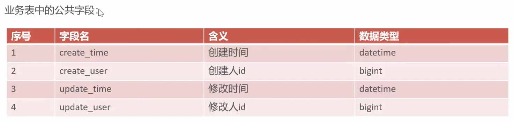
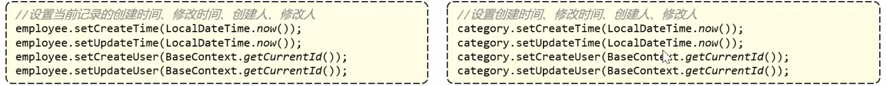
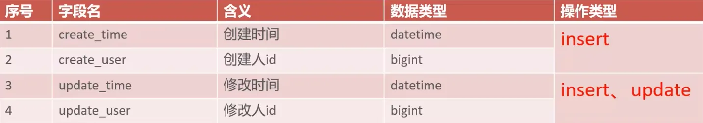
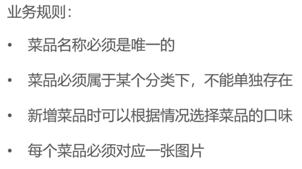
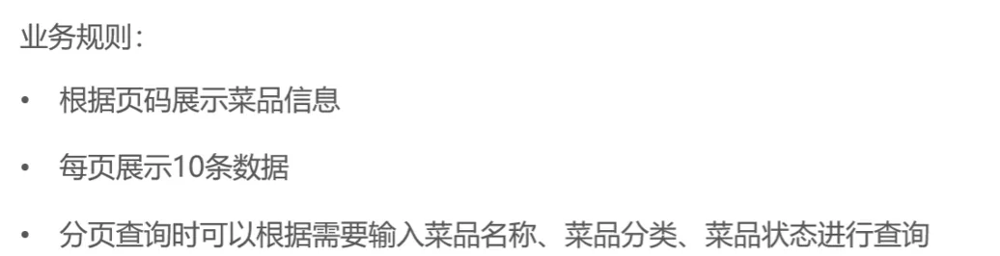
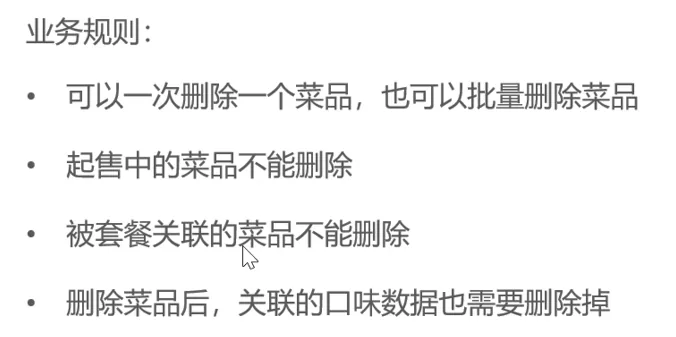
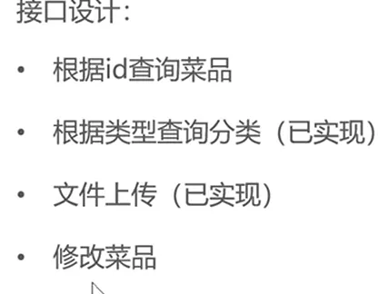

# day-03


## 本日目录

- [01-公共字段自动填充](#_01-公共字段自动填充)
- [02-新增菜品](#_02-新增菜品)
- [03-菜品的分页查询](#_03-菜品的分页查询)
- [04-删除菜品](#_04-删除菜品)
- [05-修改菜品](#_05-修改菜品)

## 01-公共字段自动填充

超级重要的内容

## 问题分析





代码冗余不便于后期维护

## 实现思路



- 自定义注解AutoFill,用于标识需要进行公共字段自动填充的方法
- 自定义切面类AutoFillAspect,统一拦截加入了AutoFill注解的方法,通过反射为公共字段赋值
- 在Mapper的方法上加入AutoFill注解

技术点如下:

1. 枚举
2. 注解
3. AOP
4. 反射

## <u>***代码实现***</u>

先说一下在这里会用到的四个文件

- AutoFill
- AutoFillAspect
- BaseContext
- OperationType

### BaseContext

这个上下文类在[day-02的01-新增员工](./day-02.md)就已经提到过一次了主要作用就是在线程中使用静态方法获取上下文信息,而我们这里要实现的公共字段自动填充跟这个东西就是一回事

```java
package com.sky.context;

public class BaseContext {

    public static ThreadLocal<Long> threadLocal = new ThreadLocal<>();

    public static void setCurrentId(Long id) {
        threadLocal.set(id);
    }

    public static Long getCurrentId() {
        return threadLocal.get();
    }

    public static void removeCurrentId() {
        threadLocal.remove();
    }

}
```

### OperationType

在 AOP 切面中配合注解使用（`@AutoFill`注解），通过标记方法对应的`OperationType`，可以自动执行不同的逻辑

```java
package com.sky.enumeration;

/**
 * 数据库操作类型
 */
public enum OperationType {

    /**
     * 更新操作
     */
    UPDATE,

    /**
     * 插入操作
     */
    INSERT

}
```

### AutoFill

- 自定义注解AutoFill,用于标识需要进行公共字段自动填充的方法

这里我们要自定义注解直接在server包下面创建一个annotation包并在annotation包中创建一个注解类AutoFill

```java
package com.sky.annotation;

import com.sky.enumeration.OperationType;

import java.lang.annotation.ElementType;
import java.lang.annotation.Retention;
import java.lang.annotation.RetentionPolicy;
import java.lang.annotation.Target;

@Target(ElementType.METHOD)
@Retention(RetentionPolicy.RUNTIME)
public @interface AutoFill {
    OperationType value();
}
```

- `@Target(ElementType.METHOD)`：指定该注解只能用于**方法上**（不能用于类、字段等其他元素）。
- `@Retention(RetentionPolicy.RUNTIME)`：指定注解在**运行时仍然有效**，可以通过反射机制获取注解信息
- `OperationType value();`：定义了一个名为`value`的属性，类型是`OperationType`（一个枚举类）
- 使用时需要为该属性赋值，例如`@AutoFill(OperationType.INSERT)`或`@AutoFill(OperationType.UPDATE)`

> 需要注意的是value属性也可以是别的自定义名字只不过使用value的话可以在使用注解的时候省去传值那一步
> 

### AutoFillAspect

这里有一个很重要的点就是如何理解AutoFill跟AutoFillAspect之间的关系,我认为可以类比为声明一个泛型接口以及泛型接口实现的代码这样的关系

- **AutoFill是声明一个注解**
- **AutoFillAspect就是写了这个注解具体的使用逻辑**

接下来就看具体的代码实现了

```java
package com.sky.aspect;

import com.sky.annotation.AutoFill;
import com.sky.constant.AutoFillConstant;
import com.sky.context.BaseContext;
import com.sky.enumeration.OperationType;
import lombok.extern.slf4j.Slf4j;
import org.aspectj.lang.JoinPoint;

import org.aspectj.lang.annotation.Aspect;
import org.aspectj.lang.annotation.Before;
import org.aspectj.lang.annotation.Pointcut;
import org.aspectj.lang.reflect.MethodSignature;
import org.springframework.stereotype.Component;

import java.lang.reflect.Method;
import java.time.LocalDateTime;

//自定义切面
@Aspect
@Component
@Slf4j
public class AutoFillAspect {

    @Pointcut("execution(* com.sky.mapper.*.*(..)) && @annotation(com.sky.annotation.AutoFill)")
    public void autoFillPointCut() {
    }

    //前置通知,在通知中进行公共字段的赋值
    @Before("autoFillPointCut()")
    public void autoFill(JoinPoint joinPoint) {
        log.info("开始进行公共字段的填充...");
        //获取到当前被拦截的方法上的数据库操作类型
        MethodSignature signature = (MethodSignature) joinPoint.getSignature();//方法签名对象
        AutoFill autoFill = signature.getMethod().getAnnotation(AutoFill.class);//获得方法上的注解对象
        OperationType operationType = autoFill.value();//获得数据库操作类型
        //获取到当前被拦截的方法的参数--实体对象
        Object[] args = joinPoint.getArgs();
        if (args == null || args.length == 0) {
            return;
        }
        Object entity = args[0];

        //准备赋值的数据
        LocalDateTime now = LocalDateTime.now();
        Long currentId = BaseContext.getCurrentId();
        //根据当前不同的操作类型,为对应的属性通过反射来赋值
        if (operationType == OperationType.INSERT) {
            //为四个公共字段赋值
            try {
                Method setCreateTime = entity.getClass().getDeclaredMethod(AutoFillConstant.SET_CREATE_TIME, LocalDateTime.class);
                Method setCreateUser = entity.getClass().getDeclaredMethod(AutoFillConstant.SET_CREATE_USER, Long.class);
                Method setUpdateTime = entity.getClass().getDeclaredMethod(AutoFillConstant.SET_UPDATE_TIME, LocalDateTime.class);
                Method setUpdateUser = entity.getClass().getDeclaredMethod(AutoFillConstant.SET_UPDATE_USER, Long.class);
                //通过反射对对象属性进行赋值
                setCreateTime.invoke(entity, now);
                setCreateUser.invoke(entity, currentId);
                setUpdateTime.invoke(entity, now);
                setUpdateUser.invoke(entity, currentId);
            } catch (Exception e) {
                e.printStackTrace();
            }
        } else if (operationType == OperationType.UPDATE) {
            //为两个公共字段赋值
            try {
                Method setUpdateTime = entity.getClass().getDeclaredMethod(AutoFillConstant.SET_UPDATE_TIME, LocalDateTime.class);
                Method setUpdateUser = entity.getClass().getDeclaredMethod(AutoFillConstant.SET_UPDATE_USER, Long.class);
                //通过反射对对象属性进行赋值
                setUpdateTime.invoke(entity, now);
                setUpdateUser.invoke(entity, currentId);
            } catch (Exception e) {
                e.printStackTrace();
            }
        }
    }
}
```

1. 首先需要注意的是装饰器@Aspect以及@Component,前者只是声明这是一个切面类并没有注册到Spring的IOC容器中,必须得声明后者才能注册
2. 然后就是说一下我目前对AOP编程思想理解吧,整个项目是一个三维的长方体,而AOP编程就是在中间切出一个面来然后再在这个面里面找到切入点,然后在对这个切入点进行操作

所以在上面的代码里面首先使用@Pointcut在特定位置声明一个切入点方法,然后再用@Before前置通知传入上面的切入点表明前置通知要对哪些切入点进行操作

在有@Before装饰的autoFill方法中传入JoinPoint接口,它**封装了被拦截方法的关键信息,**允许我们在切面中获取和操作与被拦截方法相关的数据

简单来说,当切面拦截到目标方法（被 @AutoFill 标记的方法）时,JoinPoint就像一个 “数据载体”,帮我们拿到该方法的各种信息,比如方法名、参数、所属类等
下面的几步操作就是对JoinPoint进行逐层解构

1. 获取方法签名对象
2. 获取对象里的注解对象
3. 获取注解对象中的value属性

此时就能获取OperationType这个枚举类的枚举常量也就能获得数据库的操作类型
再下面就是从JoinPoint 对象中拿出目标方法中传入的参数对象使用Object数组进行接收

保险起见判断接收到的对象是否为空

然后对对象数组中的第一位对象参数进行接收然后准备赋值的数据,需要注意的是使用上下文静态方法来对id进行赋值

接下来就是根据不同的操作类型对得到的对象进行不同的赋值操作

这里就要用到反射赋值,本质是**通过 “约定大于配置” 的思想实现通用逻辑**

只要遵循这个约定就可以一键赋值而不是给每一种对象都写一个if判断
所以这里的代码就是使用从Object对象数组中获取的名为entity对象进行get操作获取方法

 `Method setCreateTime = entity.getClass().getDeclaredMethod(AutoFillConstant.SET_CREATE_TIME, LocalDateTime.class);`
这句的意思就是先获取实体的javabean类然后再在类里面获取方法,在`getDeclaredMethod` 中传入两个参数第一个是方法名第二个是传入方法的参数类型

这里是因为java中支持方法重载,实体类中可能存在多个相同的方法但是根据传入不同的参数来进行不同方法的匹配

这样我们就能精确的拿到实体类中的方法

下一步就是对拿到的方法进行反射赋值

其中第一个传入的参数解释如下:

- 对于**非静态方法**（如实体类的 `setCreateTime`），必须传入具体的对象实例（如 `entity`），否则会报错。
- 对于**静态方法**，这个参数可以传 `null`（因为静态方法属于类，不依赖对象实例）。

反射操作需要说明一下:

传入entity不是为了说明这里的方法在entity这个实体类中而是为了<u>**指定entity这个实体类执行这个在上面声明出来的方法**</u>

## 结语

哈哈今天第一块的内容就让我学了好久,之前没接触过反射什么的,AOP编程在javaweb+ai里面也是一笔带过,这次这个公共字段自动填充让我好好思考了一番,也算学了点新东西

## 02-新增菜品

## 需求分析和设计

会有一个文件上传的东西 



## 代码实现

### 文件上传

#### application.yml

```yaml
spring:
  profiles:
    active: dev
```

```yaml
sky:
  alioss:
    endpoint: ${sky.alioss.endpoint}
    access-key-id: ${sky.alioss.access-key-id}
    access-key-secret: ${sky.alioss.access-key-secret}
    bucket-name: ${sky.alioss.bucket-name}
```

基本就这两个片段配置一下,第一个是选择dev的配置文件然后动态配置环境

#### application-dev.yml

配置一下即可

```yaml
sky:
  alioss:
    endpoint: oss-cn-beijing.aliyuncs.com
    bucket-name: chimingchangyin
    access-key-secret: *****
    access-key-id: *****
```

#### AliOssProperties

**`@ConfigurationProperties(prefix = "sky.alioss")`**

将配置文件（`application.yml`）中指定前缀的配置项，自动映射到当前类的属性中。

```java
package com.sky.properties;

import lombok.Data;
import org.springframework.boot.context.properties.ConfigurationProperties;
import org.springframework.stereotype.Component;

@Component
@ConfigurationProperties(prefix = "sky.alioss")
@Data
public class AliOssProperties {

    private String endpoint;
    private String accessKeyId;
    private String accessKeySecret;
    private String bucketName;

}
```

#### OssConfiguration

这里需要注意的是@Configuration跟@Bean以及@ConditionalOnMissingBean

@Configuration标记当前类是一个配置类,相当于传统Spring中的XML文件,所以说能在这里读取AliOssProperties的配置

@Bean表明AliOssUtil返回的对象要注册进IOC容器

@ConditionalOnMissingBean配合起来使用可以避免重复注册

```java
package com.sky.config;

import com.sky.properties.AliOssProperties;
import com.sky.utils.AliOssUtil;
import lombok.extern.slf4j.Slf4j;
import org.springframework.boot.autoconfigure.condition.ConditionalOnMissingBean;
import org.springframework.context.annotation.Bean;
import org.springframework.context.annotation.Configuration;

//配置类,用于创建AliOssUtil对象
@Configuration
@Slf4j
public class OssConfiguration {

    @Bean
    @ConditionalOnMissingBean
    public AliOssUtil aliOssUtil(AliOssProperties aliOssProperties) {
        log.info("开始创建阿里文件上传工具对象:{}", aliOssProperties);
        return new AliOssUtil(aliOssProperties.getEndpoint(),
                aliOssProperties.getAccessKeyId(),
                aliOssProperties.getAccessKeySecret(),
                aliOssProperties.getBucketName());
                //在这里传入配置当中的值进入工具类
                //因为工具类中是有@Data的
    }
}
```

#### AliOssUtil

```java
package com.sky.utils;

import com.aliyun.oss.ClientException;
import com.aliyun.oss.OSS;
import com.aliyun.oss.OSSClientBuilder;
import com.aliyun.oss.OSSException;
import lombok.AllArgsConstructor;
import lombok.Data;
import lombok.extern.slf4j.Slf4j;
import java.io.ByteArrayInputStream;

@Data
@AllArgsConstructor
@Slf4j
public class AliOssUtil {

    private String endpoint;
    private String accessKeyId;
    private String accessKeySecret;
    private String bucketName;

    /**
     * 文件上传
     *
     * @param bytes
     * @param objectName
     * @return
     */
    public String upload(byte[] bytes, String objectName) {

        // 创建OSSClient实例。
        OSS ossClient = new OSSClientBuilder().build(endpoint, accessKeyId, accessKeySecret);

        try {
            // 创建PutObject请求。
            ossClient.putObject(bucketName, objectName, new ByteArrayInputStream(bytes));
        } catch (OSSException oe) {
            System.out.println("Caught an OSSException, which means your request made it to OSS, "
                    + "but was rejected with an error response for some reason.");
            System.out.println("Error Message:" + oe.getErrorMessage());
            System.out.println("Error Code:" + oe.getErrorCode());
            System.out.println("Request ID:" + oe.getRequestId());
            System.out.println("Host ID:" + oe.getHostId());
        } catch (ClientException ce) {
            System.out.println("Caught an ClientException, which means the client encountered "
                    + "a serious internal problem while trying to communicate with OSS, "
                    + "such as not being able to access the network.");
            System.out.println("Error Message:" + ce.getMessage());
        } finally {
            if (ossClient != null) {
                ossClient.shutdown();
            }
        }

        //文件访问路径规则 https://BucketName.Endpoint/ObjectName
        StringBuilder stringBuilder = new StringBuilder("https://");
        stringBuilder
                .append(bucketName)
                .append(".")
                .append(endpoint)
                .append("/")
                .append(objectName);

        log.info("文件上传到:{}", stringBuilder.toString());

        return stringBuilder.toString();
    }
}
```

### Controller

#### CommonController

文件上传的工具类就是在这里注入的

```java
package com.sky.controller.admin;

import com.sky.constant.MessageConstant;
import com.sky.result.Result;
import com.sky.utils.AliOssUtil;
import lombok.extern.slf4j.Slf4j;
import org.springframework.beans.factory.annotation.Autowired;
import org.springframework.web.bind.annotation.PostMapping;
import org.springframework.web.bind.annotation.RequestMapping;
import org.springframework.web.bind.annotation.RestController;
import org.springframework.web.multipart.MultipartFile;

import java.io.IOException;
import java.util.UUID;

@RestController
@RequestMapping("admin/common")
@Slf4j
public class CommonController {
    @Autowired
    private AliOssUtil aliOssUtil;

    @PostMapping("/upload")
    public Result<String> upload(MultipartFile file){
        log.info("文件上传:{}",file);
        try {
            //原始文件名
            String originalFilename = file.getOriginalFilename();
            //截取原始文件名的后缀
            String extension = originalFilename.substring(originalFilename.lastIndexOf("."));
            String objectName = UUID.randomUUID().toString() + extension;
            String filePath = aliOssUtil.upload(file.getBytes(), objectName);
            return Result.success(filePath);
        } catch (IOException e) {
            log.error("文件上传失败:{}",e);
        }
        return Result.error(MessageConstant.UPLOAD_FAILED);
    }
}
```

#### DishController

```java
package com.sky.controller.admin;

import com.sky.dto.DishDTO;
import com.sky.result.Result;
import com.sky.service.DishService;
import lombok.extern.slf4j.Slf4j;
import org.springframework.beans.factory.annotation.Autowired;
import org.springframework.web.bind.annotation.PostMapping;
import org.springframework.web.bind.annotation.RequestBody;
import org.springframework.web.bind.annotation.RequestMapping;
import org.springframework.web.bind.annotation.RestController;

@Slf4j
@RestController
@RequestMapping("/admin/dish")
public class DishController {
    @Autowired
    private DishService dishService;

    @PostMapping
    public Result save(@RequestBody DishDTO dishDTO) {
        log.info("新增菜品:{}", dishDTO);
        dishService.saveWithFlavor(dishDTO);
        return Result.success();
    }
}
```

### Service

```java
package com.sky.service;

import com.sky.dto.DishDTO;

public interface DishService {
    void saveWithFlavor(DishDTO dishDTO);
}
```

```java
package com.sky.service.impl;

import com.sky.dto.DishDTO;
import com.sky.entity.Dish;
import com.sky.entity.DishFlavor;
import com.sky.mapper.DishFlavorMapper;
import com.sky.mapper.DishMapper;
import com.sky.service.DishService;
import lombok.extern.slf4j.Slf4j;
import org.springframework.beans.BeanUtils;
import org.springframework.beans.factory.annotation.Autowired;
import org.springframework.stereotype.Service;
import org.springframework.transaction.annotation.Transactional;

import java.util.List;

@Service
@Slf4j
public class DishServiceImpl implements DishService {
    @Autowired
    private DishMapper dishMapper;
    @Autowired
    private DishFlavorMapper dishFlavorMapper;

    @Override
    @Transactional(rollbackFor = Exception.class)
    public void saveWithFlavor(DishDTO dishDTO) {
        Dish dish = new Dish();
        BeanUtils.copyProperties(dishDTO, dish);
        //向菜品表插入1条数据
        dishMapper.insert(dish);
        Long dishId = dish.getId();
        //向口味表插入n条数据
        List<DishFlavor> flavors = dishDTO.getFlavors();
        if (flavors != null && flavors.size() > 0) {
            flavors.forEach(flavor -> {
                flavor.setDishId(dishId);
            });
            dishFlavorMapper.insertBatch(flavors);
        }
    }
}
```

这里因为数据要插入两张表所以这里要开启事务管理`@Transactional(rollbackFor = Exception.class)`

然后就是使用对象属性复制将DTO对象转化为Entity对象然后对菜品表执行插入操作然后重要的来了这里使用的是逻辑外键所以我们需要插入的同时实现数据的回显所以在mapper映射文件中会有一个小考点,暂且不表

然后就是插入成功之后获得id回显让其成为口味的逻辑外键

接下来就是使用变量接收DTO中的口味单列集合如果不为空的话进行遍历赋值逻辑外键

遍历完成后调用Mapper接口使用动态sql进行批量插入

### Mapper

#### DishMapper

因为是插入操作所以要使用公共字段自动填充

```java
package com.sky.mapper;

import com.sky.annotation.AutoFill;
import com.sky.entity.Dish;
import com.sky.enumeration.OperationType;
import org.apache.ibatis.annotations.Mapper;
import org.apache.ibatis.annotations.Select;

@Mapper
public interface DishMapper {

    /**
     * 根据分类id查询菜品数量
     * @param categoryId
     * @return
     */
    @Select("select count(id) from dish where category_id = #{categoryId}")
    Integer countByCategoryId(Long categoryId);

    @AutoFill(value = OperationType.INSERT)
    void insert(Dish dish);
}
```

#### DishMapper.xml

这里需要的点就是useGeneratedKeys以及keyProperty

**`useGeneratedKeys="true"`** 开启主键回显功能

**`keyProperty="id"`** 指定主键值要回显到id属性上

需要注意这里不是随意的赋值操作要跟java对象属性之间有绑定关系

```xml
<?xml version="1.0" encoding="UTF-8" ?>
<!DOCTYPE mapper PUBLIC "-//mybatis.org//DTD Mapper 3.0//EN"
        "http://mybatis.org/dtd/mybatis-3-mapper.dtd" >
<mapper namespace="com.sky.mapper.DishMapper">

    <insert id="insert" useGeneratedKeys="true" keyProperty="id">
        insert into dish (name,
                          category_id,
                          price,
                          image,
                          description,
                          create_time,
                          update_time,
                          create_user,
                          update_user,
                          status)
        values (#{name},
                #{categoryId},
                #{price},
                #{image},
                #{description},
                #{createTime},
                #{updateTime},
                #{createUser},
                #{updateUser},
                #{status})
    </insert>
</mapper>
```

#### DishFlavorMapper

```java
package com.sky.mapper;

import com.sky.entity.DishFlavor;
import org.apache.ibatis.annotations.Mapper;

import java.util.List;

@Mapper
public interface DishFlavorMapper {

    void insertBatch(List<DishFlavor> flavors);
}
```

#### DishFlavorMapper.xml

这里就没什么好说的了就是动态sql

```xml
<?xml version="1.0" encoding="UTF-8" ?>
<!DOCTYPE mapper PUBLIC "-//mybatis.org//DTD Mapper 3.0//EN"
        "http://mybatis.org/dtd/mybatis-3-mapper.dtd" >
<mapper namespace="com.sky.mapper.DishFlavorMapper">
    <insert id="insertBatch">
        insert into dish_flavor (dish_id,name,value) values
        <foreach collection="flavors" item="df" separator=",">
            (#{df.dishId},#{df.name},#{df.value})
        </foreach>
    </insert>
</mapper>
```

## 结语

最后我有点累了所以学的效率比较低下最后就是回宿舍躺了一会然后晚上回来写的第二个新增菜品的总结,那会困的时候根本不知道自己在干什么,浅浅浪费了一点时间

## 03-菜品的分页查询

## 需求分析和设计



## 代码实现

### Controller

老样子分页查询get请求所以要用返回泛型PageResult

```java
@GetMapping("/page")
public Result<PageResult> page(DishPageQueryDTO dishPageQueryDTO) {
    log.info("菜品分页查询");
    PageResult pageResult = dishService.page(dishPageQueryDTO);
    return Result.success(pageResult);
}
```

### Service

```java
PageResult page(DishPageQueryDTO dishPageQueryDTO);
```

```java
@Override
public PageResult page(DishPageQueryDTO dishPageQueryDTO) {
    PageHelper.startPage(dishPageQueryDTO.getPage(),dishPageQueryDTO.getPageSize());
    Page<DishVO> page = dishMapper.pageQuery(dishPageQueryDTO);
    return new PageResult(page.getTotal(),page.getResult());
}
```

依旧是使用PageHelper来进行分页查询

这里也是终于用上了[VO视图对象](./day-01.md)这是给前端展示用的对象

### Mapper

```java
Page<DishVO> pageQuery(DishPageQueryDTO dishPageQueryDTO);
```

```java
<select id="pageQuery" resultType="com.sky.vo.DishVO">
    select d.* , c.name as categoryName from dish d left outer join category c on d.category_id = c.id
    <where>
        <if test="name != null">
            and d.name like concat('%',#{name},'%')
        </if>
        <if test="categoryId != null">
            and d.category_id like concat('%',#{categoryId},'%')
        </if>
        <if test="status != null">
            and d.status like concat('%',#{status},'%')
        </if>
    </where>
    order by d.create_time desc
</select>
```

使用别名来命名然后下面都是老样子模糊搜索

## 总结

没什么新东西全是复习老东西不过这样其实也挺好的加深一下记忆

## 04-删除菜品

## 需求分析和设计



## 代码实现

### Controller

使用@RequestParam来读取url中的请求参数

```java
@DeleteMapping
public Result delete(@RequestParam List<Long> ids) {
    log.info("菜品批量删除:{}",ids);
    dishService.delete(ids);
    return Result.success();
}
```

### Service

```java
void delete(List<Long> ids);
```

```java
@Override
public void delete(List<Long> ids) {
    //判断当前菜品是否能够删除--是否存在起售中的菜品
    for (Long id : ids) {
        Dish dish = dishMapper.getById(id);
        if(dish.getStatus() == StatusConstant.ENABLE){
            //商品属于起售中,不能删除
            throw new DeletionNotAllowedException(MessageConstant.DISH_ON_SALE);
        }
    }
    //判断当前菜品是否能够删除--是否被套餐关联了
    List<Long> setMealIds = setMealDishMapper.getSetMealDishIdByDishId(ids);
    if(setMealIds != null && setMealIds.size() > 0){
        throw new DeletionNotAllowedException(MessageConstant.DISH_BE_RELATED_BY_SETMEAL);
    }
    //删除菜品表中的菜品数据
    //ids.forEach(id -> {
    //    dishMapper.deleteById(id);
    //    dishFlavorMapper.deleteByDishId(id);
    //});
    dishMapper.deleteByIds(ids);
    dishFlavorMapper.deleteByDishIds(ids);
}
```

先遍历判断是否能删除菜品然后在对菜品进行删除

### Mapper

```java
List<Long> getSetMealDishIdByDishId(List<Long> dishIds);
```

```xml
<select id="getSetMealDishIdByDishId" resultType="java.lang.Long">
    select setmeal_id from setmeal_dish where dish_id in
    <foreach collection="dishIds" item="dishId" separator="," open="(" close=')'>
        #{dishId}
    </foreach>
</select>
```

```java
void deleteByDishIds(List<Long> ids);
```

```xml
<delete id="deleteByDishIds">
    delete from dish_flavor where dish_id in
    <foreach collection="ids" open="(" close=")" separator="," item="id">
        #{id}
    </foreach>
</delete>
```

## 05-修改菜品

## 需求设计和分析



## 代码实现

### Controller

```java
@GetMapping("/{id}")
public Result<DishVO> getById(@PathVariable Long id) {
    log.info("根据id查询菜品:{}",id);
    DishVO dishVO = dishService.getByIdWithFlavor(id);
    return Result.success(dishVO);
}
@PutMapping
public Result update(@RequestBody DishDTO dishDTO) {
    log.info("修改菜品:{}",dishDTO);
    dishService.updateWithFLavor(dishDTO);
    return Result.success();
}
```

### Service

```java
DishVO getByIdWithFlavor(Long id);
void updateWithFLavor(DishDTO dishDTO);
```

```java
@Override
public DishVO getByIdWithFlavor(Long id) {
    //根据id查询菜品数据
    Dish dish = dishMapper.getById(id);
    //根据菜品id查询口味数据
    List<DishFlavor> dishFlavors = dishFlavorMapper.ge
    //将查询到的数据封装的到VO
    DishVO dishVO = new DishVO();
    BeanUtils.copyProperties(dish, dishVO);
    dishVO.setFlavors(dishFlavors);
    return dishVO;
}
@Override
public void updateWithFLavor(DishDTO dishDTO) {
    Dish dish = new Dish();
    BeanUtils.copyProperties(dishDTO, dish);
    //修改菜品表基本信息
    dishMapper.update(dish);
    //删除原有的口味数据
    dishFlavorMapper.deleteByDishId(dish.getId());
    //重新插入口味数据
    List<DishFlavor> flavors = dishDTO.getFlavors();
    if (flavors != null && flavors.size() > 0) {
        flavors.forEach(flavor -> {
            flavor.setDishId(dishDTO.getId());
        });
        dishFlavorMapper.insertBatch(flavors);
    }
}
```

### Mapper

```java
@Select("select * from dish_flavor where dish_id = #{id}")
List<DishFlavor> getByDishId(Long id);
```
