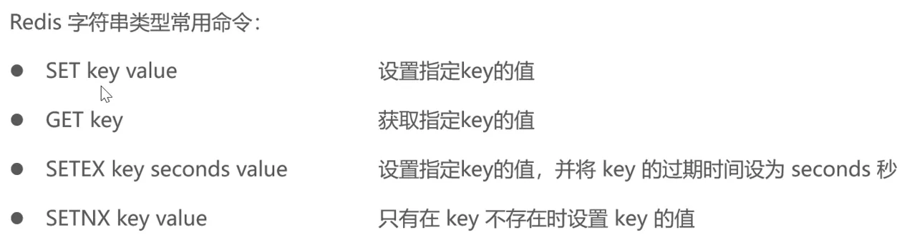
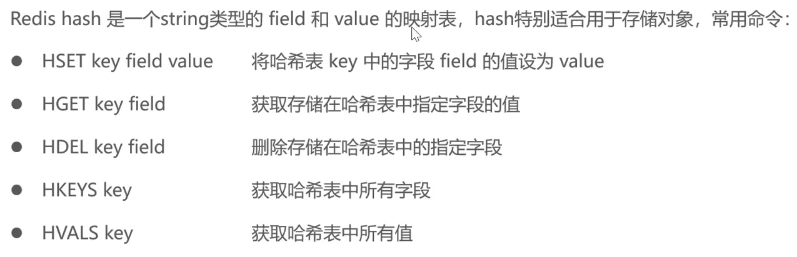
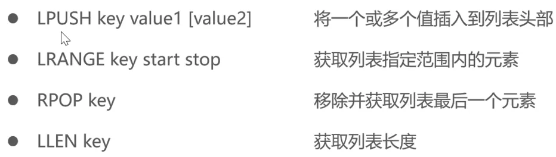
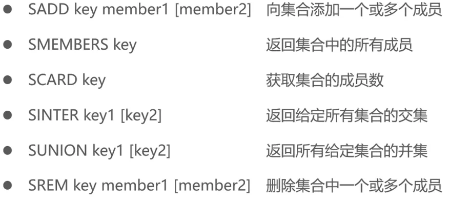
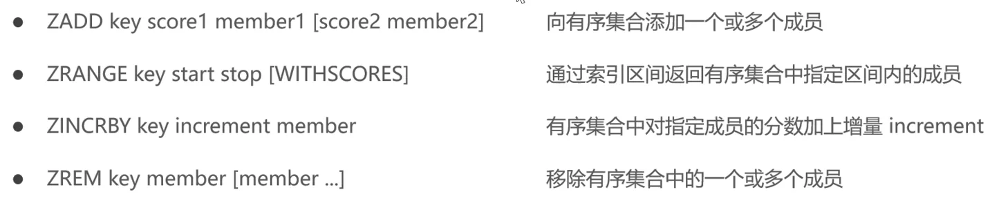
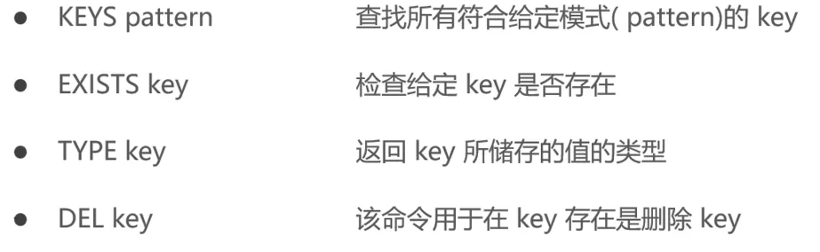
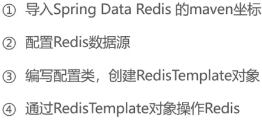
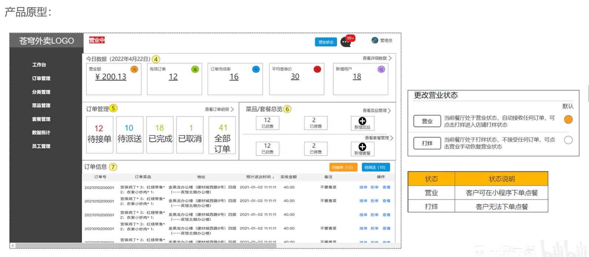

# day-05


## 本日目录

- [Redis入门](#redis入门)
- [Redis常用数据类型](#redis常用数据类型)
- [Redis常用命令](#redis常用命令)
- [在java中操作Redis](#在java中操作redis)
- [店铺营业状态设置](#店铺营业状态设置)

## Redis入门

## Redis简介

Redis是一个基于内存的key-value结构数据库

- 基于内存存储,读写性能高
- 适合存储热点数据(热点商品 资讯 新闻)
- 企业应用广泛

emmm其实这块也没啥东西我直接连接到我自己服务器上Redis

## Redis常用数据类型

Redis存储的是key-value结构的数据,其中key是字符串类型,value有5种常用的数据类型:

- 字符串 String 普通字符串,redis中最简单的数据类型
- 哈希 hash 也叫散列,类似于java中的HashMap结构
- 列表 list 按照插入顺序排序,可以有重复元素,类似于java中的LinkedList
- 集合 set 无序集合,没有重复元素,类似于java当中的HashSet
- 有序集合 sorted set / zset 集合中每一个元素关联一个分数(score),根据分数升序排序,没有重复元素

## Redis常用命令

## 字符串操作命令



## 哈希操作命令



## 列表操作命令



## 集合操作命令



## 有序集合操作命令



## 通用命令



## 在java中操作Redis



## 导入maven坐标

```xml
<dependency>
    <groupId>org.springframework.boot</groupId>
    <artifactId>spring-boot-starter-data-redis</artifactId>
</dependency>
```

## 配置Redis数据源

### application.yml

```yaml
spring:
	redis:
  host: ${sky.redis.host}
  prot: ${sky.redis.port}
  password: ${sky.redis.password}
  database: ${sky.redis.database}
```

application-dev.yml

```yaml
sky:
	redis:
  host: 154.37.215.94
  port: 6379
  password: redis_GEGpKR
  database: 0
```

## 编写配置类,创建RedisTemplate对象

一些无聊的测试类废话懒得听算了

```java
package com.sky.test;

import org.junit.jupiter.api.Test;
import org.springframework.beans.factory.annotation.Autowired;
import org.springframework.boot.test.context.SpringBootTest;
import org.springframework.data.redis.core.*;

import java.util.List;
import java.util.Set;
import java.util.concurrent.TimeUnit;

@SpringBootTest
public class SpringDataRedisTest {
    @Autowired
    private RedisTemplate redisTemplate;

    @Test
    public void testRedisTemplate() {
        System.out.println(redisTemplate);
        ValueOperations valueOperations = redisTemplate.opsForValue();
        HashOperations hashOperations = redisTemplate.opsForHash();
        ListOperations listOperations = redisTemplate.opsForList();
        SetOperations setOperations = redisTemplate.opsForSet();
        ClusterOperations clusterOperations = redisTemplate.opsForCluster();
    }

    @Test
    public void testString() {
        redisTemplate.opsForValue().set("city", "北京");
        Object city = redisTemplate.opsForValue().get("city");
        System.out.println(city);
        redisTemplate.opsForValue().set("code","1234", 3, TimeUnit.MINUTES);
        redisTemplate.opsForValue().setIfAbsent("lock","1");
        redisTemplate.opsForValue().setIfAbsent("lock","2");
    }

    @Test
    public void testHash(){
        HashOperations hashOperations = redisTemplate.opsForHash();
        hashOperations.put("100","name","tom");
        hashOperations.put("100","age","20");

        Object name = hashOperations.get("100", "name");
        System.out.println(name);

        Set keys = hashOperations.keys("100");
        System.out.println(keys);

        List values = hashOperations.values("100");
        System.out.println(values);

        hashOperations.delete("100","age");
    }

    @Test
    public void testList(){
        ListOperations listOperations = redisTemplate.opsForList();
        listOperations.leftPushAll("mylist","a","b","c");
        listOperations.leftPush("mylist","d");

        List mylist = listOperations.range("mylist", 0, -1);
        System.out.println(mylist);

        listOperations.rightPop("mylist");

        Long size = listOperations.size("mylist");
        System.out.println(size);
    }
}

```

## 店铺营业状态设置

## 需求分析和设计



## 代码开发

## Config

#### RedisConfigration

之前还是有点不太理解@Configuration跟@Bean配合起来的作用

在这里算是理解了,@Configuration声明这是一个配置类然后@Bean进行依赖注入注解的函数返回的对象

通常用于第三方组件或需要复杂配置的Bean

```java
package com.sky.config;

import lombok.extern.slf4j.Slf4j;
import org.springframework.context.annotation.Bean;
import org.springframework.context.annotation.Configuration;
import org.springframework.data.redis.connection.RedisConnectionFactory;
import org.springframework.data.redis.core.RedisTemplate;
import org.springframework.data.redis.serializer.StringRedisSerializer;

@Configuration
@Slf4j
public class RedisConfiguration {
    @Bean
    public RedisTemplate redisTemplate(RedisConnectionFactory redisConnectionFactory) {
        RedisTemplate redisTemplate = new RedisTemplate();
        //设置redis的链接工厂对象
        redisTemplate.setConnectionFactory(redisConnectionFactory);
        //设置redis key的序列化器
        redisTemplate.setKeySerializer(new StringRedisSerializer());

        return redisTemplate;
    }
}
```

### Controller

也是比较好理解把依赖注入到这个Controller中然后直接调用这个注入的Redis模板直接根据请求进行操作Redis数据库

#### ShopController

```java
package com.sky.controller.admin;

import com.sky.result.Result;
import lombok.extern.slf4j.Slf4j;
import org.springframework.beans.factory.annotation.Autowired;
import org.springframework.data.redis.core.RedisTemplate;
import org.springframework.web.bind.annotation.*;

@RestController("adminShopController")
@RequestMapping("/admin/shop")
@Slf4j
public class ShopController {
    public static final String KEY = "SHOP_STATUS";

    @Autowired
    private RedisTemplate redisTemplate;

    @PutMapping("/{status}")
    public Result setStatus(@PathVariable Integer status) {
        log.info("设置店铺的营业状态:{}", status);
        redisTemplate.opsForValue().set(KEY, status);
        return Result.success();
    }

    @GetMapping("/status")
    public Result<Integer> getStatus(){
        Integer shopStatus = (Integer) redisTemplate.opsForValue().get(KEY);
        log.info("获取到店铺的营业状态为:{}",shopStatus);
        return Result.success(shopStatus);
    }
}
```

#### ShopController

```java
package com.sky.controller.user;

import com.sky.result.Result;
import lombok.extern.slf4j.Slf4j;
import org.springframework.beans.factory.annotation.Autowired;
import org.springframework.data.redis.core.RedisTemplate;
import org.springframework.web.bind.annotation.GetMapping;
import org.springframework.web.bind.annotation.RequestMapping;
import org.springframework.web.bind.annotation.RestController;

@RestController("userShopController")
@RequestMapping("/user/shop")
@Slf4j
public class ShopController {
    public static final String KEY = "SHOP_STATUS";

    @Autowired
    private RedisTemplate redisTemplate;

    @GetMapping("/status")
    public Result<Integer> getShop(){
        Integer shopStatus = (Integer) redisTemplate.opsForValue().get(KEY);
        log.info("shopStatus:{}", shopStatus);
        return Result.success(shopStatus);
    }
}
```

## 功能测试
