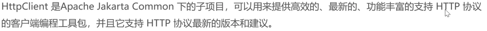
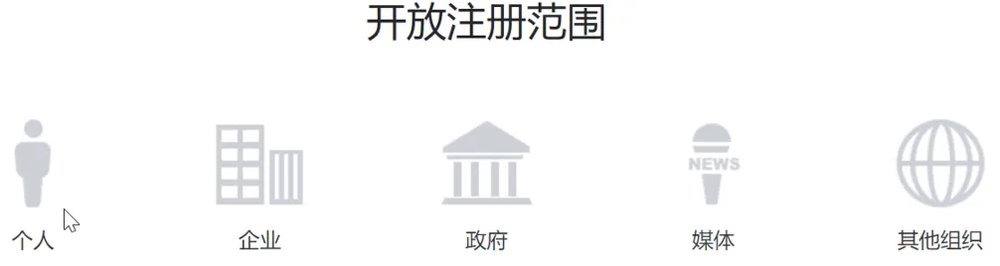
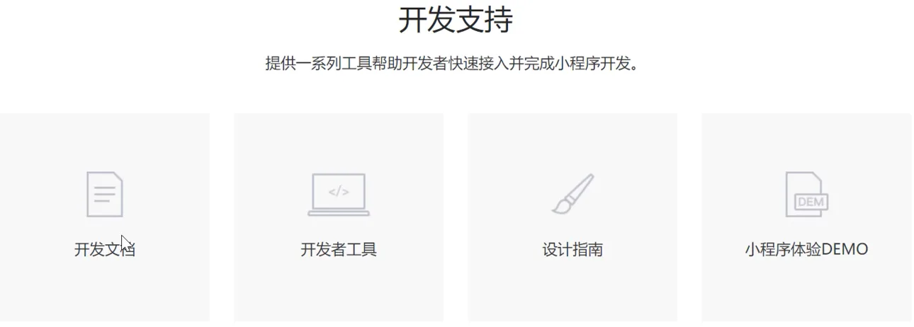
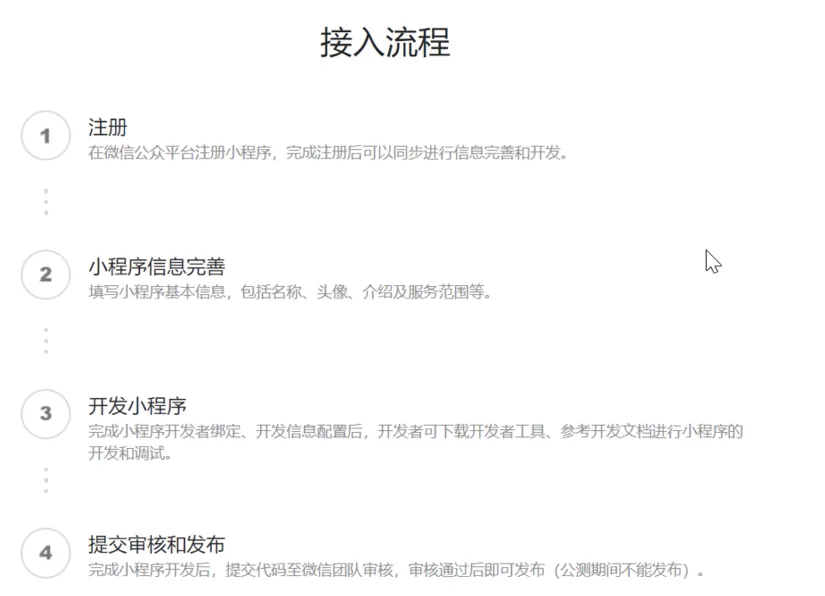
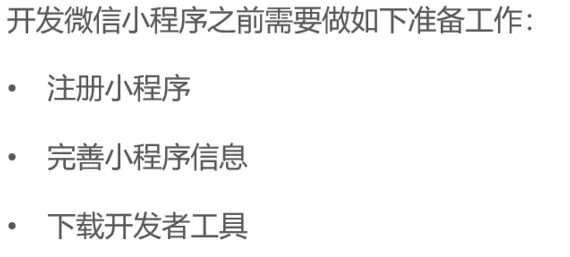
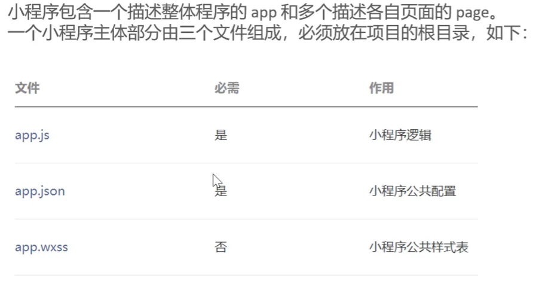
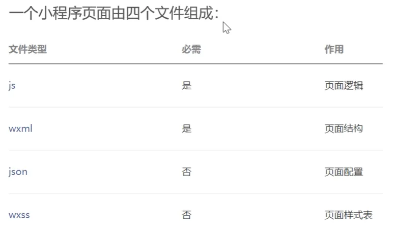
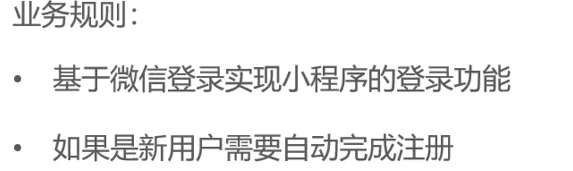

# day-06


## 本日目录

- [01-HttpClient](#_01-httpclient)
- [02-微信小程序开发](#_02-微信小程序开发)
- [03-微信登录](#_03-微信登录)
- [导入商品浏览功能代码](#导入商品浏览功能代码)

## 01-HttpClient

## 介绍



### 核心API

- HttpClient
- HttpClients
- CloseableHttpClient
- HttpGet
- HttpPost

### 发送请求步骤

- 创建HttpClient对象
- 创建Http请求对象
- 调用HttpClient的execute方法发送请求

## 入门案例

没啥东西其实就是一个测试类测试了一下

```java
package com.sky.test;

import com.alibaba.fastjson.JSONObject;
import org.apache.http.HttpEntity;
import org.apache.http.client.methods.CloseableHttpResponse;
import org.apache.http.client.methods.HttpGet;
import org.apache.http.client.methods.HttpPost;
import org.apache.http.entity.StringEntity;
import org.apache.http.impl.client.CloseableHttpClient;
import org.apache.http.impl.client.HttpClients;
import org.apache.http.util.EntityUtils;
import org.junit.jupiter.api.Test;
import org.springframework.boot.test.context.SpringBootTest;

@SpringBootTest
public class HttpClientTest {
    @Test
    public void testGet() throws Exception{
        CloseableHttpClient httpClient = HttpClients.createDefault();
        HttpGet httpGet = new HttpGet("http://localhost:8080/user/shop/status");
        CloseableHttpResponse response = httpClient.execute(httpGet);

        int statusCode = response.getStatusLine().getStatusCode();
        System.out.println("statusCode:" + statusCode);

        HttpEntity entity = response.getEntity();
        String body = EntityUtils.toString(entity);
        System.out.println("body:" + body);

        response.close();
        httpClient.close();
    }

    @Test
    public void testPost() throws Exception{
        CloseableHttpClient httpClient = HttpClients.createDefault();
        HttpPost httpPost = new HttpPost("http://localhost:8080/admin/employee/login");
        JSONObject jsonObject = new JSONObject();
        jsonObject.put("username", "admin");
        jsonObject.put("password", "123456");
        StringEntity entity = new StringEntity(jsonObject.toString());

        entity.setContentEncoding("UTF-8");
        entity.setContentType("application/json");
        httpPost.setEntity(entity);

        CloseableHttpResponse response = httpClient.execute(httpPost);
        int statusCode = response.getStatusLine().getStatusCode();
        System.out.println("statusCode:" + statusCode);

        HttpEntity entity1 = response.getEntity();
        String body = EntityUtils.toString(entity1);
        System.out.println("body:" + body);

        response.close();
        httpClient.close();
    }
}
```

## 02-微信小程序开发

小程序是一种新的开放能力,开发者可以快速的开发一个小程序

小程序可以在微信内被便捷的获取和传播,同事具有出色的使用体验

## 介绍







## 准备工作



狗屁一堆麻烦的注册步骤绷不住啦

## 入门案例

### 小程序目录结构





一些前端的东西感觉比vue3简单多了

## 03-微信登录

## 需求分析和设计



## 代码实现

### WechatProperties

@Component
@ConfigurationProperties(prefix = "sky.wechat")

这两句配合起来使用就能在配置文件里面配置这个属性类

@Component注入IOC容器然后直接在yml拿出来用就行 

```java
package com.sky.properties;

import lombok.Data;
import org.springframework.boot.context.properties.ConfigurationProperties;
import org.springframework.stereotype.Component;

@Component
@ConfigurationProperties(prefix = "sky.wechat")
@Data
public class WeChatProperties {

    private String appid; //小程序的appid
    private String secret; //小程序的秘钥
    private String mchid; //商户号
    private String mchSerialNo; //商户API证书的证书序列号
    private String privateKeyFilePath; //商户私钥文件
    private String apiV3Key; //证书解密的密钥
    private String weChatPayCertFilePath; //平台证书
    private String notifyUrl; //支付成功的回调地址
    private String refundNotifyUrl; //退款成功的回调地址

}
```

### application.yml

```yaml
sky:
  wechat:
    appid: ${sky.wechat.appid}
    secret: ${sky.wechat.secret}
```

### application-dev.yml

```yaml
sky:
	wechat:
	  appid: 脱敏
	  secret: 脱敏
```

### UserService

没什么好说的以后用不用的到都还不知道

```java
package com.sky.service.impl;

import com.alibaba.fastjson.JSON;
import com.alibaba.fastjson.JSONObject;
import com.sky.constant.MessageConstant;
import com.sky.dto.UserLoginDTO;
import com.sky.entity.User;
import com.sky.exception.LoginFailedException;
import com.sky.mapper.UserMapper;
import com.sky.properties.WeChatProperties;
import com.sky.service.UserService;
import com.sky.utils.HttpClientUtil;
import lombok.extern.slf4j.Slf4j;
import org.springframework.beans.factory.annotation.Autowired;
import org.springframework.stereotype.Service;

import java.time.LocalDateTime;
import java.util.HashMap;
import java.util.Map;

@Service
@Slf4j
public class UserServiceImpl implements UserService {

    //微信服务接口地址
    public static final String WX_LOGIN = "https://api.weixin.qq.com/sns/jscode2session";

    @Autowired
    private WeChatProperties weChatProperties;

    @Autowired
    private UserMapper userMapper;

    @Override
    public User wxLogin(UserLoginDTO userLoginDTO) {
        //调用微信接口服务获得微信用户的openid
        String openid = getOpenid(userLoginDTO.getCode());

        //判断openid是否为空,如果为空表示登录失败,抛出业务异常
        if (openid == null) {
            throw new LoginFailedException(MessageConstant.LOGIN_FAILED);
        }
        //判断当前用户是否为新用户
        User user = userMapper.getByOpenid(openid);
        //如果是新用户,自动完成注册
        if (user == null) {
            user = User.builder()
                    .openid(openid)
                    .createTime(LocalDateTime.now())
                    .build();
            userMapper.insert(user);
        }
        //返回这个用户对象
        return user;
    }

    private String getOpenid(String code) {
        Map<String, String> map = new HashMap<>();
        map.put("appid", weChatProperties.getAppid());
        map.put("secret", weChatProperties.getSecret());
        map.put("js_code", code);
        map.put("grant_type", "authorization_code");
        String json = HttpClientUtil.doGet(WX_LOGIN, map);

        JSONObject jsonObject = JSON.parseObject(json);
        String openid = jsonObject.getString("openid");
        return openid;
    }
}

```

## 导入商品浏览功能代码

没什么特点就纯导入,这节的内容无聊的很
