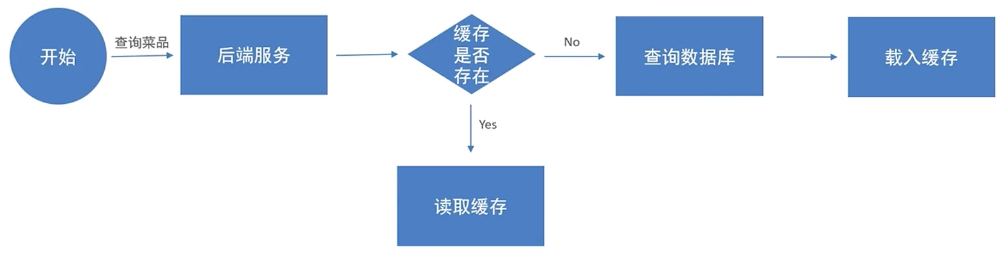
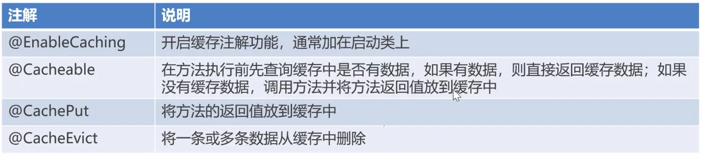
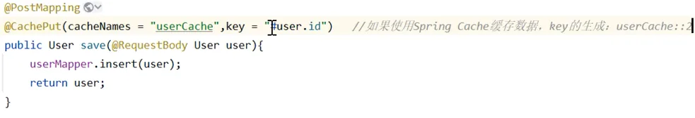

# day-07

> 《苍穹外卖》day-07：缓存与购物车

## 本日目录

- [01-缓存菜品](#_01-缓存菜品)
- [02-缓存套餐](#_02-缓存套餐)
- [03-添加购物车](#_03-添加购物车)

## 01-缓存菜品

## 问题说明

用户端小程序展示的菜品数据都是通过查询数据库获得,如果用户端访问量比较大,数据库访问压力随之增大

## 实现思路

通过Redis来缓存菜品数据,减少数据库查询操作



缓存逻辑分析:

- 每个分类下的菜品保存一份缓存数据
- 数据库中菜品数据有变更时清理缓存数据

## 代码实现

### Controller

```java
package com.sky.controller.admin;

import com.sky.dto.DishDTO;
import com.sky.dto.DishPageQueryDTO;
import com.sky.result.PageResult;
import com.sky.result.Result;
import com.sky.service.DishService;
import com.sky.vo.DishVO;
import lombok.extern.slf4j.Slf4j;
import org.springframework.beans.factory.annotation.Autowired;
import org.springframework.data.redis.core.RedisTemplate;
import org.springframework.web.bind.annotation.*;

import java.util.List;
import java.util.Set;

@Slf4j
@RestController
@RequestMapping("/admin/dish")
public class DishController {
    @Autowired
    private DishService dishService;
    @Autowired
    private RedisTemplate redisTemplate;

    @PostMapping
    public Result save(@RequestBody DishDTO dishDTO) {
        log.info("新增菜品:{}", dishDTO);
        dishService.saveWithFlavor(dishDTO);
        String key = "dish_" + dishDTO.getCategoryId();
        cleanCache(key);
        return Result.success();
    }

    @GetMapping("/page")
    public Result<PageResult> page(DishPageQueryDTO dishPageQueryDTO) {
        log.info("菜品分页查询:{}", dishPageQueryDTO);
        PageResult pageResult = dishService.page(dishPageQueryDTO);
        return Result.success(pageResult);
    }

    @DeleteMapping
    public Result delete(@RequestParam List<Long> ids) {
        log.info("菜品批量删除:{}", ids);
        dishService.delete(ids);

        //将所有的菜品缓存数据清理掉,所有以dish_开头有的key
        cleanCache("dish_*");
        return Result.success();
    }

    @GetMapping("/{id}")
    public Result<DishVO> getById(@PathVariable Long id) {
        log.info("根据id查询菜品:{}", id);
        DishVO dishVO = dishService.getByIdWithFlavor(id);
        return Result.success(dishVO);
    }

    @PutMapping
    public Result update(@RequestBody DishDTO dishDTO) {
        log.info("修改菜品:{}", dishDTO);
        dishService.updateWithFLavor(dishDTO);

        cleanCache("dish_*");
        return Result.success();
    }

    @GetMapping("/list")
    public Result<List<DishVO>> getByCategoryId(@RequestParam Long categoryId) {
        log.info("根据分类id查询菜品:{}", categoryId);
        List<DishVO> dishVOList = dishService.getByCategoryId(categoryId);
        return Result.success(dishVOList);
    }

    @PostMapping("/status/{status}")
    public Result updateStatus(@PathVariable Integer status, @RequestParam Long id) {
        log.info("更新菜品售卖状态:{},{}", status,id);
        dishService.updateStatus(status,id);
        cleanCache("dish_*");
        return Result.success();
    }

    private void cleanCache(String pattern) {
        Set keys = redisTemplate.keys(pattern);
        redisTemplate.delete(keys);
    }
}
```

在下面新增一个服用的私有方法传入redis缓存的表名并删除在增删改的时候调用删除

这里顺便还写了一个更新菜品售卖状态的

### Service

```java
void updateStatus(Integer status, Long id);
```

```java
@Override
public void updateStatus(Integer status, Long id) {
    Dish dish = dishMapper.getById(id);
    dish.setStatus(status);
    dishMapper.update(dish);
}
```

也不需要新的Mapper接口直接查询出来setStatus之后更新dish即可

## 02-缓存套餐

## Spring Cache

Spring Cache是一个框架,实现了基于注解的缓存功能,只需要简单的加一个注解,就能实现缓存功能

Spring Cache提供了一层抽象,底层可以切换不同的缓存实现,例如:

- EHCache
- Caffeine
- Redis





## 实现思路

- 导入Spring Cache和Redis相关的maven坐标
- 在启动类上加入@EnableCaching注解,开启缓存注解功能
- 在用户端接口SetmealController的list方法上加入@Cacheable注解
- 在管理端接口SetmealController的save,delete,update,startOrStop等方法上加入CacheEvict注解

## 代码实现

### 启动类

添加注解@EnableCaching开启缓存注解功能

```java
package com.sky;

import lombok.extern.slf4j.Slf4j;
import org.springframework.boot.SpringApplication;
import org.springframework.boot.autoconfigure.SpringBootApplication;
import org.springframework.cache.annotation.EnableCaching;
import org.springframework.transaction.annotation.EnableTransactionManagement;

@SpringBootApplication
@EnableTransactionManagement //开启注解方式的事务管理
@EnableCaching//开启缓存注解功能
@Slf4j
public class SkyApplication {
    public static void main(String[] args) {
        SpringApplication.run(SkyApplication.class, args);
        log.info("server started");
    }
}
```

### Controller

#### 用户端SetmealController

查询增加注解@Cacheable(cacheNames = "setmealCache", key = "#categoryId")

在get前先在Redis中查询如果没有就新增缓存

```java
@GetMapping("/list")
@ApiOperation("根据分类id查询套餐")
@Cacheable(cacheNames = "setmealCache", key = "#categoryId")
public Result<List<Setmeal>> list(Long categoryId) {
    Setmeal setmeal = new Setmeal();
    setmeal.setCategoryId(categoryId);
    setmeal.setStatus(StatusConstant.ENABLE);
    List<Setmeal> list = setmealService.list(setmeal);
    return Result.success(list);
}
```

#### 管理端SetmealController

增删改加一样的将多条数据从Redis中删除

```java
@PostMapping("/status/{status}")
@CacheEvict(cacheNames = "setmealCache",allEntries = true)
public Result updateStatus(@PathVariable Integer status,@RequestParam Long id){
    log.info("设置状态:{}{}",status,id);
    setMealService.updateStatus(status,id);
    return Result.success();
}
@PutMapping
@CacheEvict(cacheNames = "setmealCache",allEntries = true)
public Result update(@RequestBody SetmealDTO setmealDTO){
    log.info("修改套餐:{}", setmealDTO);
    setMealService.update(setmealDTO);
    return Result.success();
}
@DeleteMapping
@CacheEvict(cacheNames = "setmealCache",allEntries = tru
public Result delete(@RequestParam List<Long> ids){
    log.info("批量删除套餐:{}",ids);
    setMealService.delete(ids);
    return Result.success();
}
@PostMapping
@CacheEvict(cacheNames = "setmealCache",key = "#setmealDTO.categoryId")
public Result save(@RequestBody SetmealDTO setmealDTO){
    log.info("新增套餐:{}",setmealDTO);
    setMealService.save(setmealDTO);
    return Result.success();
}
```

## 03-添加购物车

## 需求分析和设计

这里我主要了解了购物车的数据库设计

1. 想要使用建造者模式的便捷语法必须在实体类上使用@Builder注解
2. Serializable接口的实现就是为了标注序列化和反序列化对象因为java中的类要用于网络传输
3. `serialVersionUID` 就像类的 "序列化身份证号"，显式声明它可以**避免类结构变化导致的序列化兼容性问题**，尤其在需要持久化存储或网络传输对象的场景（如购物车、用户会话等）中非常重要。这里显式声明了serialVersionUID之后也就是让缓存的旧对象也能兼容新对象
4. 还有就是购物车的设计一条购物车记录一个菜品或者套餐什么的最后查询购物车的时候直接使用userId查询即可

```java
package com.sky.entity;

import lombok.AllArgsConstructor;
import lombok.Builder;
import lombok.Data;
import lombok.NoArgsConstructor;

import java.io.Serializable;
import java.math.BigDecimal;
import java.time.LocalDateTime;

/**
 * 购物车
 */
@Data
@Builder
@NoArgsConstructor
@AllArgsConstructor
public class ShoppingCart implements Serializable {

    private static final long serialVersionUID = 1L;

    private Long id;

    //名称
    private String name;

    //用户id
    private Long userId;

    //菜品id
    private Long dishId;

    //套餐id
    private Long setmealId;

    //口味
    private String dishFlavor;

    //数量
    private Integer number;

    //金额
    private BigDecimal amount;

    //图片
    private String image;

    private LocalDateTime createTime;
}
```

## 代码实现

### Controller

增删改没毛病老铁也没啥特殊的地方

```java
package com.sky.controller.user;

import com.sky.dto.ShoppingCartDTO;
import com.sky.entity.ShoppingCart;
import com.sky.result.Result;
import com.sky.service.ShoppingCartService;
import lombok.extern.slf4j.Slf4j;
import org.springframework.beans.factory.annotation.Autowired;
import org.springframework.web.bind.annotation.*;

import java.util.List;

@RestController
@Slf4j
@RequestMapping("/user/shoppingCart")
public class ShoppingCartController {
    @Autowired
    private ShoppingCartService shoppingCartService;

    @PostMapping("/add")
    public Result add(@RequestBody ShoppingCartDTO shoppingCartDTO){
        log.info("添加购物车,商品信息为:{}",shoppingCartDTO);
        shoppingCartService.add(shoppingCartDTO);
        return Result.success();
    }

    @GetMapping("/list")
    public Result<List<ShoppingCart>> list(){
        List<ShoppingCart> list = shoppingCartService.showShoppingCart();
        return Result.success(list);
    }

    @DeleteMapping("/clean")
    public Result delete(){
        shoppingCartService.delete();
        return Result.success();
    }
}
```

### Service

这里唯一稍微复杂的逻辑就是增加逻辑但其实也不复杂就是代码量多了一些

首先要判断这个菜品是否存在如果不存在的话就根据判断是菜品还是套餐,如果存在的话就plus1,最后插入

```java
package com.sky.service;

import com.sky.dto.ShoppingCartDTO;
import com.sky.entity.ShoppingCart;

import java.util.List;

public interface ShoppingCartService {
    void add(ShoppingCartDTO shoppingCartDTO);

    List<ShoppingCart> showShoppingCart();

    void delete();
}

```

```java
package com.sky.service.impl;

import com.sky.context.BaseContext;
import com.sky.dto.ShoppingCartDTO;
import com.sky.entity.Dish;
import com.sky.entity.Setmeal;
import com.sky.entity.ShoppingCart;
import com.sky.mapper.DishMapper;
import com.sky.mapper.SetmealMapper;
import com.sky.mapper.ShoppingCartMapper;
import com.sky.service.ShoppingCartService;
import org.springframework.beans.BeanUtils;
import org.springframework.beans.factory.annotation.Autowired;
import org.springframework.stereotype.Service;

import java.time.LocalDateTime;
import java.util.List;

@Service
public class ShoppingCartServiceImpl implements ShoppingCartService {
    @Autowired
    private ShoppingCartMapper shoppingCartMapper;
    @Autowired
    private DishMapper dishMapper;
    @Autowired
    private SetmealMapper setmealMapper;

    @Override
    public void add(ShoppingCartDTO shoppingCartDTO) {
        //判断当前加入到购物车当中的菜品是否存在
        ShoppingCart shoppingCart = new ShoppingCart();
        BeanUtils.copyProperties(shoppingCartDTO, shoppingCart);
        Long userId = BaseContext.getCurrentId();
        shoppingCart.setUserId(userId);
        List<ShoppingCart> list = shoppingCartMapper.list(shoppingCart);
        //如果已经存在了就+1
        if (list != null && list.size() > 0) {
            ShoppingCart cart = list.get(0);
            cart.setNumber(cart.getNumber() + 1);
            shoppingCartMapper.updateNumberById(cart);
        } else {
            //如果不存在,需要插入一条购物车数据
            Long dishId = shoppingCartDTO.getDishId();
            if (dishId != null) {
                //本次添加到购物车的是菜品
                Dish dish = dishMapper.getById(dishId);
                shoppingCart.setName(dish.getName());
                shoppingCart.setImage(dish.getImage());
                shoppingCart.setAmount(dish.getPrice());
            } else {
                Long setmealId = shoppingCartDTO.getSetmealId();
                Setmeal setmeal = setmealMapper.getById(setmealId);
                shoppingCart.setName(setmeal.getName());
                shoppingCart.setImage(setmeal.getImage());
                shoppingCart.setAmount(setmeal.getPrice());
            }
            shoppingCart.setNumber(1);
            shoppingCart.setCreateTime(LocalDateTime.now());
            shoppingCartMapper.insert(shoppingCart);
        }
    }

    @Override
    public List<ShoppingCart> showShoppingCart() {
        Long userId = BaseContext.getCurrentId();
        ShoppingCart shoppingCart = ShoppingCart.builder()
                .userId(userId)
                .build();
        List<ShoppingCart> list = shoppingCartMapper.list(shoppingCart);
        return list;
    }

    @Override
    public void delete() {
        Long userId = BaseContext.getCurrentId();
        shoppingCartMapper.delete(userId);
    }
}
```

### Mapper

```java
package com.sky.mapper;

import com.sky.entity.ShoppingCart;
import org.apache.ibatis.annotations.Delete;
import org.apache.ibatis.annotations.Insert;
import org.apache.ibatis.annotations.Mapper;
import org.apache.ibatis.annotations.Update;

import java.util.List;

@Mapper
public interface ShoppingCartMapper {
    List<ShoppingCart> list(ShoppingCart shoppingCart);

    @Update("update shopping_cart set number = #{number} where id = #{id}")
    void updateNumberById(ShoppingCart shoppingCart);

    @Insert("insert into shopping_cart(name, image, user_id, dish_id, setmeal_id, dish_flavor, number, amount, create_time) " +
            "VALUES (#{name}, #{image}, #{userId}, #{dishId}, #{setmealId}, #{dishFlavor}, #{number}, #{amount}, #{createTime})")
    void insert(ShoppingCart shoppingCart);

    @Delete("delete from shopping_cart where user_id = #{userId}")
    void delete(Long userId);
}
```

```xml
<?xml version="1.0" encoding="UTF-8" ?>
<!DOCTYPE mapper PUBLIC "-//mybatis.org//DTD Mapper 3.0//EN"
        "http://mybatis.org/dtd/mybatis-3-mapper.dtd" >
<mapper namespace="com.sky.mapper.ShoppingCartMapper">

    <select id="list" resultType="com.sky.entity.ShoppingCart">
        select * from shopping_cart
        <where>
            <if test="userId != null">
                and user_id = #{userId}
            </if>
            <if test="setmealId != null">
                and setmeal_id = #{setmealId}
            </if>
            <if test="dishId != null">
                and dish_id = #{dishId}
            </if>
            <if test="dishFlavor != null">
                and dish_flavor = #{dishFlavor}
            </if>
        </where>
    </select>
</mapper>

```
