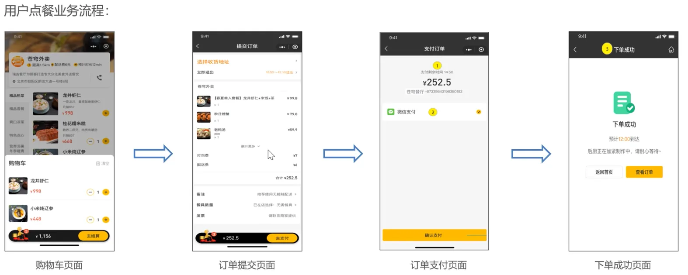
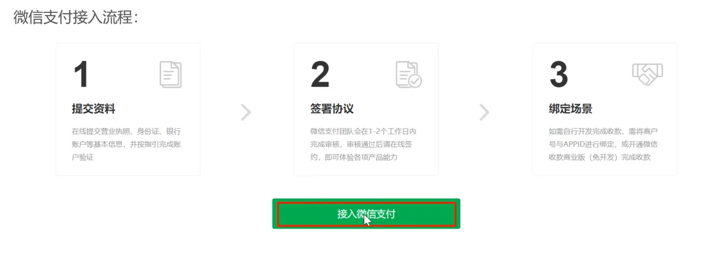
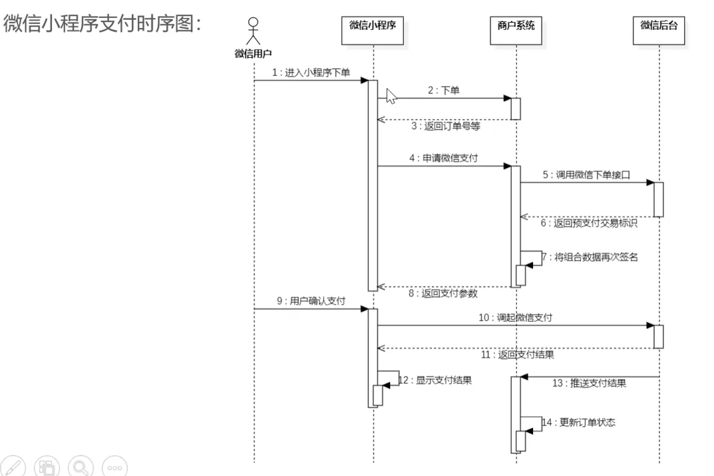
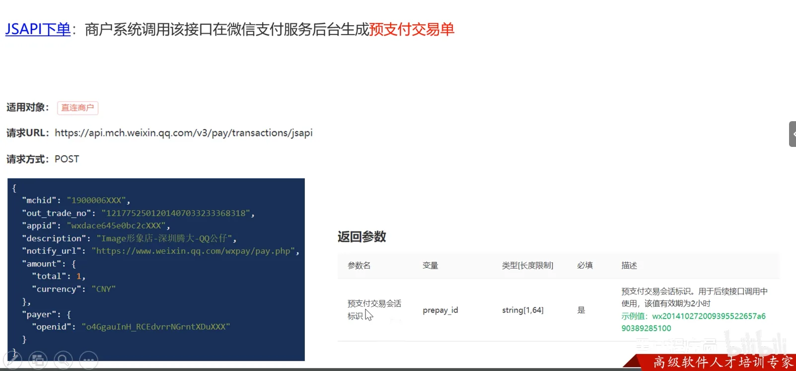

# day-08


## 本日目录

- [01-导入地址簿功能代码](#_01-导入地址簿功能代码)
- [02-用户下单](#_02-用户下单)
- [01-微信支付介绍](#_01-微信支付介绍)
- [03-订单支付](#_03-订单支付)

## 01-导入地址簿功能代码

## 代码分析

其实没啥好分析的都是老样子

### Controller

```java
package com.sky.controller.user;

import com.sky.context.BaseContext;
import com.sky.entity.AddressBook;
import com.sky.result.Result;
import com.sky.service.AddressBookService;
import io.swagger.annotations.Api;
import io.swagger.annotations.ApiOperation;
import org.springframework.beans.factory.annotation.Autowired;
import org.springframework.web.bind.annotation.*;
import java.util.List;

@RestController
@RequestMapping("/user/addressBook")
@Api(tags = "C端地址簿接口")
public class AddressBookController {

    @Autowired
    private AddressBookService addressBookService;

    /**
     * 查询当前登录用户的所有地址信息
     *
     * @return
     */
    @GetMapping("/list")
    @ApiOperation("查询当前登录用户的所有地址信息")
    public Result<List<AddressBook>> list() {
        AddressBook addressBook = new AddressBook();
        addressBook.setUserId(BaseContext.getCurrentId());
        List<AddressBook> list = addressBookService.list(addressBook);
        return Result.success(list);
    }

    /**
     * 新增地址
     *
     * @param addressBook
     * @return
     */
    @PostMapping
    @ApiOperation("新增地址")
    public Result save(@RequestBody AddressBook addressBook) {
        addressBookService.save(addressBook);
        return Result.success();
    }

    @GetMapping("/{id}")
    @ApiOperation("根据id查询地址")
    public Result<AddressBook> getById(@PathVariable Long id) {
        AddressBook addressBook = addressBookService.getById(id);
        return Result.success(addressBook);
    }

    /**
     * 根据id修改地址
     *
     * @param addressBook
     * @return
     */
    @PutMapping
    @ApiOperation("根据id修改地址")
    public Result update(@RequestBody AddressBook addressBook) {
        addressBookService.update(addressBook);
        return Result.success();
    }

    /**
     * 设置默认地址
     *
     * @param addressBook
     * @return
     */
    @PutMapping("/default")
    @ApiOperation("设置默认地址")
    public Result setDefault(@RequestBody AddressBook addressBook) {
        addressBookService.setDefault(addressBook);
        return Result.success();
    }

    /**
     * 根据id删除地址
     *
     * @param id
     * @return
     */
    @DeleteMapping
    @ApiOperation("根据id删除地址")
    public Result deleteById(Long id) {
        addressBookService.deleteById(id);
        return Result.success();
    }

    /**
     * 查询默认地址
     */
    @GetMapping("default")
    @ApiOperation("查询默认地址")
    public Result<AddressBook> getDefault() {
        //SQL:select * from address_book where user_id = ? and is_default = 1
        AddressBook addressBook = new AddressBook();
        addressBook.setIsDefault(1);
        addressBook.setUserId(BaseContext.getCurrentId());
        List<AddressBook> list = addressBookService.list(addressBook);

        if (list != null && list.size() == 1) {
            return Result.success(list.get(0));
        }

        return Result.error("没有查询到默认地址");
    }

}
```

### Service

```java
package com.sky.service;

import com.sky.entity.AddressBook;
import java.util.List;

public interface AddressBookService {

    List<AddressBook> list(AddressBook addressBook);

    void save(AddressBook addressBook);

    AddressBook getById(Long id);

    void update(AddressBook addressBook);

    void setDefault(AddressBook addressBook);

    void deleteById(Long id);

}
```

```java
package com.sky.service.impl;

import com.sky.context.BaseContext;
import com.sky.entity.AddressBook;
import com.sky.mapper.AddressBookMapper;
import com.sky.service.AddressBookService;
import lombok.extern.slf4j.Slf4j;
import org.springframework.beans.factory.annotation.Autowired;
import org.springframework.stereotype.Service;
import org.springframework.transaction.annotation.Transactional;
import java.util.List;

@Service
@Slf4j
public class AddressBookServiceImpl implements AddressBookService {
    @Autowired
    private AddressBookMapper addressBookMapper;

    /**
     * 条件查询
     *
     * @param addressBook
     * @return
     */
    public List<AddressBook> list(AddressBook addressBook) {
        return addressBookMapper.list(addressBook);
    }

    /**
     * 新增地址
     *
     * @param addressBook
     */
    public void save(AddressBook addressBook) {
        addressBook.setUserId(BaseContext.getCurrentId());
        addressBook.setIsDefault(0);
        addressBookMapper.insert(addressBook);
    }

    /**
     * 根据id查询
     *
     * @param id
     * @return
     */
    public AddressBook getById(Long id) {
        AddressBook addressBook = addressBookMapper.getById(id);
        return addressBook;
    }

    /**
     * 根据id修改地址
     *
     * @param addressBook
     */
    public void update(AddressBook addressBook) {
        addressBookMapper.update(addressBook);
    }

    /**
     * 设置默认地址
     *
     * @param addressBook
     */
    @Transactional
    public void setDefault(AddressBook addressBook) {
        //1、将当前用户的所有地址修改为非默认地址 update address_book set is_default = ? where user_id = ?
        addressBook.setIsDefault(0);
        addressBook.setUserId(BaseContext.getCurrentId());
        addressBookMapper.updateIsDefaultByUserId(addressBook);

        //2、将当前地址改为默认地址 update address_book set is_default = ? where id = ?
        addressBook.setIsDefault(1);
        addressBookMapper.update(addressBook);
    }

    /**
     * 根据id删除地址
     *
     * @param id
     */
    public void deleteById(Long id) {
        addressBookMapper.deleteById(id);
    }

}
```

### Mapper

```java
package com.sky.mapper;

import com.sky.entity.AddressBook;
import org.apache.ibatis.annotations.*;
import java.util.List;

@Mapper
public interface AddressBookMapper {

    /**
     * 条件查询
     * @param addressBook
     * @return
     */
    List<AddressBook> list(AddressBook addressBook);

    /**
     * 新增
     * @param addressBook
     */
    @Insert("insert into address_book" +
            "        (user_id, consignee, phone, sex, province_code, province_name, city_code, city_name, district_code," +
            "         district_name, detail, label, is_default)" +
            "        values (#{userId}, #{consignee}, #{phone}, #{sex}, #{provinceCode}, #{provinceName}, #{cityCode}, #{cityName}," +
            "                #{districtCode}, #{districtName}, #{detail}, #{label}, #{isDefault})")
    void insert(AddressBook addressBook);

    /**
     * 根据id查询
     * @param id
     * @return
     */
    @Select("select * from address_book where id = #{id}")
    AddressBook getById(Long id);

    /**
     * 根据id修改
     * @param addressBook
     */
    void update(AddressBook addressBook);

    /**
     * 根据 用户id修改 是否默认地址
     * @param addressBook
     */
    @Update("update address_book set is_default = #{isDefault} where user_id = #{userId}")
    void updateIsDefaultByUserId(AddressBook addressBook);

    /**
     * 根据id删除地址
     * @param id
     */
    @Delete("delete from address_book where id = #{id}")
    void deleteById(Long id);

}
```

```xml
<?xml version="1.0" encoding="UTF-8" ?>
<!DOCTYPE mapper PUBLIC "-//mybatis.org//DTD Mapper 3.0//EN" "http://mybatis.org/dtd/mybatis-3-mapper.dtd" >
<mapper namespace="com.sky.mapper.AddressBookMapper">

    <select id="list" parameterType="AddressBook" resultType="AddressBook">
        select * from address_book
        <where>
            <if test="userId != null">
                and user_id = #{userId}
            </if>
            <if test="phone != null">
                and phone = #{phone}
            </if>
            <if test="isDefault != null">
                and is_default = #{isDefault}
            </if>
        </where>
    </select>

    <update id="update" parameterType="addressBook">
        update address_book
        <set>
            <if test="consignee != null">
                consignee = #{consignee},
            </if>
            <if test="sex != null">
                sex = #{sex},
            </if>
            <if test="phone != null">
                phone = #{phone},
            </if>
            <if test="detail != null">
                detail = #{detail},
            </if>
            <if test="label != null">
                label = #{label},
            </if>
            <if test="isDefault != null">
                is_default = #{isDefault},
            </if>
        </set>
        where id = #{id}
    </update>

</mapper>

```

## 02-用户下单

## 需求分析和设计

用户下单业务说明:

在电商系统中,用户是通过下单的方式通知商家,用户已经购买了商品,需要商家进行备货和发货

用户下单后会产生订单相关数据,订单数据需要能够体现如下的信息:

- 买的哪些商品?每个商品的数量是多少?
- 订单总金额是多少?
- 收货地址是哪?
- 哪个用户下的单?
- 用户手机号是多少?



## 代码开发

### Controller

没什么特殊之处

```java
package com.sky.controller.user;

import com.sky.dto.OrdersSubmitDTO;
import com.sky.result.Result;
import com.sky.service.OrderService;
import com.sky.vo.OrderSubmitVO;
import lombok.extern.slf4j.Slf4j;
import org.springframework.beans.factory.annotation.Autowired;
import org.springframework.web.bind.annotation.PostMapping;
import org.springframework.web.bind.annotation.RequestBody;
import org.springframework.web.bind.annotation.RequestMapping;
import org.springframework.web.bind.annotation.RestController;

@RestController
@RequestMapping("/user/order")
@Slf4j
public class OrderController {
    @Autowired
    private OrderService orderService;

    @PostMapping("/submit")
    public Result<OrderSubmitVO> submit(@RequestBody OrdersSubmitDTO ordersSubmitDTO){
        log.info("用户下单,参数为:{}",ordersSubmitDTO);
        OrderSubmitVO orderSubmitVO = orderService.submitOrder(ordersSubmitDTO);
        return Result.success(orderSubmitVO);
    }
}
```

### Service

这里也就是处理购物车提交全部信息的时候流程麻烦一点但也没什么特殊的地方主要就是想清楚流程即可

```java
package com.sky.service;

import com.sky.dto.OrdersSubmitDTO;
import com.sky.vo.OrderSubmitVO;

public interface OrderService {
    OrderSubmitVO submitOrder(OrdersSubmitDTO ordersSubmitDTO);
}
```

```java
package com.sky.service.impl;

import com.sky.constant.MessageConstant;
import com.sky.context.BaseContext;
import com.sky.dto.OrdersSubmitDTO;
import com.sky.entity.AddressBook;
import com.sky.entity.OrderDetail;
import com.sky.entity.Orders;
import com.sky.entity.ShoppingCart;
import com.sky.exception.AddressBookBusinessException;
import com.sky.exception.ShoppingCartBusinessException;
import com.sky.mapper.AddressBookMapper;
import com.sky.mapper.OrderDetailMapper;
import com.sky.mapper.OrderMapper;
import com.sky.mapper.ShoppingCartMapper;
import com.sky.service.OrderService;
import com.sky.vo.OrderSubmitVO;
import org.springframework.beans.BeanUtils;
import org.springframework.beans.factory.annotation.Autowired;
import org.springframework.stereotype.Service;

import java.time.LocalDateTime;
import java.util.ArrayList;
import java.util.List;

@Service
public class OrderServiceImpl implements OrderService {
    @Autowired
    private OrderMapper orderMapper;

    @Autowired
    private OrderDetailMapper orderDetailMapper;

    @Autowired
    private AddressBookMapper addressBookMapper;

    @Autowired
    private ShoppingCartMapper shoppingCartMapper;

    @Override
    public OrderSubmitVO submitOrder(OrdersSubmitDTO ordersSubmitDTO) {
        //处理各种业务异常(地址簿为空,购物车数据为空)
        AddressBook addressBook = addressBookMapper.getById(ordersSubmitDTO.getAddressBookId());
        if (addressBook == null) {
            throw new AddressBookBusinessException(MessageConstant.ADDRESS_BOOK_IS_NULL);
        }
        //查询当前前购物车数据
        Long userId = BaseContext.getCurrentId();
        ShoppingCart shoppingCart = new ShoppingCart();
        shoppingCart.setUserId(userId);
        List<ShoppingCart> shoppingCartList = shoppingCartMapper.list(shoppingCart);
        if (shoppingCartList == null || shoppingCartList.size() == 0) {
            throw new ShoppingCartBusinessException(MessageConstant.SHOPPING_CART_IS_NULL);
        }
        //向订单表插入1条数据
        Orders orders = new Orders();
        BeanUtils.copyProperties(ordersSubmitDTO, orders);
        orders.setOrderTime(LocalDateTime.now());
        orders.setPayStatus(Orders.UN_PAID);
        orders.setStatus(Orders.PENDING_PAYMENT);
        orders.setNumber(String.valueOf(System.currentTimeMillis()));
        orders.setPhone(addressBook.getPhone());
        orders.setConsignee(addressBook.getConsignee());
        orders.setUserId(userId);
        orderMapper.insert(orders);

        List<OrderDetail> orderDetailList = new ArrayList<>();
        //向订单明细表插入n条数据
        shoppingCartList.forEach(cart -> {
            OrderDetail orderDetail = new OrderDetail();
            BeanUtils.copyProperties(cart, orderDetail);
            orderDetail.setOrderId(orders.getId());
            orderDetailList.add(orderDetail);
        });

        orderDetailMapper.insertBatch(orderDetailList);
        //清空当前用户的购物车数据
        shoppingCartMapper.delete(userId);
        //封装VO返回结果
        OrderSubmitVO orderSubmitVO = OrderSubmitVO.builder()
                .id(orders.getId())
                .orderTime(orders.getOrderTime())
                .orderNumber(orders.getNumber())
                .orderAmount(orders.getAmount())
                .build();

        return orderSubmitVO;
    }
}
```

### Mapper

#### OrderDetailMapper

```java
package com.sky.mapper;

import com.sky.entity.OrderDetail;
import org.apache.ibatis.annotations.Mapper;

import java.util.List;

@Mapper
public interface OrderDetailMapper {
    void insertBatch(List<OrderDetail> orderDetailList);
}
```

```xml
<?xml version="1.0" encoding="UTF-8" ?>
<!DOCTYPE mapper PUBLIC "-//mybatis.org//DTD Mapper 3.0//EN" "http://mybatis.org/dtd/mybatis-3-mapper.dtd" >
<mapper namespace="com.sky.mapper.OrderDetailMapper">

    <insert id="insertBatch">
        insert into order_detail (name, image, order_id, dish_id, setmeal_id, dish_flavor, number, amount)
        values
        <foreach collection="orderDetailList" item="od" separator=",">
            (#{od.name},#{od.image},#{od.orderId},#{od.dishId},#{od.setmealId},#{od.dishFlavor},#{od.number},#{od.amount})
        </foreach>
    </insert>
</mapper>
```

#### OrderMapper

```java
package com.sky.mapper;

import com.sky.entity.Orders;
import org.apache.ibatis.annotations.Mapper;

@Mapper
public interface OrderMapper {

    void insert(Orders orders);
}
```

```xml
<?xml version="1.0" encoding="UTF-8" ?>
<!DOCTYPE mapper PUBLIC "-//mybatis.org//DTD Mapper 3.0//EN" "http://mybatis.org/dtd/mybatis-3-mapper.dtd" >
<mapper namespace="com.sky.mapper.OrderMapper">
    <insert id="insert" parameterType="Orders" useGeneratedKeys="true" keyProperty="id">
        insert into orders (number, status, user_id, address_book_id, order_time, checkout_time, pay_method, pay_status,
                            amount, remark, phone, address, consignee, estimated_delivery_time, delivery_status,
                            pack_amount, tableware_number, tableware_status)
        values (#{number}, #{status}, #{userId}, #{addressBookId}, #{orderTime}, #{checkoutTime}, #{payMethod},
                #{payStatus}, #{amount}, #{remark}, #{phone}, #{address}, #{consignee}, #{estimatedDeliveryTime},
                #{deliveryStatus}, #{packAmount}, #{tablewareNumber}, #{tablewareStatus})
    </insert>
</mapper>

```

## 01-微信支付介绍







## 03-订单支付

[01-微信支付介绍](#_01-微信支付介绍)


没什么用感觉用不到全是导入直接不搞了进入day09了
